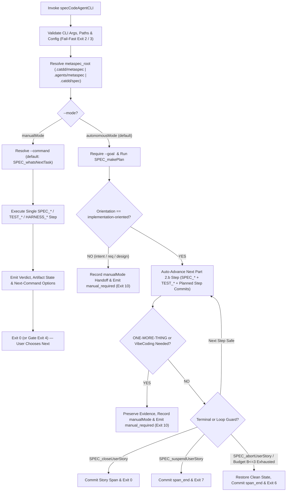

# Define Unified specCodeAgentCLI CLI UsageDesign Contract

> **Story ID:** US-specDeveloper-defineSpecCodeAgentCliUsageContract | **State:** done | **Priority:** P0
> **StoryIdAlias:** US-261111.220010
> **CreatedAt:** 2026-11-11T22:00:10+08:00
> **Source:** `.catdd/spec/analyzedNews/20261111-design-specCodeAgentCLI-usage-contract-Feature.md`
> **CaTDD Class:** P0 Functional
> **Primary Category:** Typical

---

## Active Work Status

- **Status:** CLOSED (`done`).
- **Opened by:** `/SPEC_openUserStory` on `2026-11-11` (`execution_mode: manualMode`).
- **Closed by:** `/SPEC_closeUserStory` on `2026-11-13` (`execution_mode: manualMode`).
- **Lifecycle transition:** `.catdd/spec/todoUS/` -> `.catdd/spec/doingUS/` -> `.catdd/spec/doneUS/`.
- **Branch:** `feat/specCodeAgentCLI-requirements-and-usage-design` (branch integration to `main` pending via `/SPEC_mergeWorks` after `post_close` commit).
- **Pre-story commit:** deferred by developer (`No git commits yet`; captured in `pre_close` story-span commit `be10406`).
- **Planned by:** `/SPEC_makePlan` on `2026-11-11` (`work_orientation: design-oriented` for the UsageDesign CLI contract slice).
- **Requirement & ledger review (`/SPEC_reviewUserStory`):** `PASS` on `2026-11-11` (`README_UserStories.md` synchronized; transfer to UsageDesign authoring).
- **UsageDesign artifact (`/SPEC_takeDetailDesign` scoped to CLI UsageDesign):** `codeAgents/specCodeAgentCLI/README_UsageDesign.md` authored from `slashCommands/templates/README_UsageDesignLiteCliTemplate.md`, reviewed `PASS` on `2026-11-11`, and step-committed via `/SPEC_commitStepWorks` (`step_commit_ref = 5862e55`) on `2026-11-13`.
- **Pre-close story-span commit (`/SPEC_commitStoryWorks`):** `commit_ref = be10406` committed on `2026-11-13` (`commit_checkpoint = pre_close`, after `US-SPECFLOW-REPAIR-01` `span_end` commit `2178251`).
- **Post-close story-span commit (`/SPEC_commitStoryWorks`):** committed on `2026-11-13` (`commit_checkpoint = post_close`; `close_commit_required` satisfied).
- **Verification / CI summary (`ci_summary`):** Repository contract validation suite `PASS` (`test_codeAgents_structure`, `check_readme_mirror`, `test_documentation_contract`, `test_metaspec_workspace`, `test_specflow_execution_modes`, `test_readme_templates`, `test_specflow_artifact_policy`, `test_methodPrompts_consistency`, Markdown lint, and `git diff --check`).
- **Paired tasks:** `.catdd/spec/doneUS/20261111-design-specCodeAgentCLI-usage-contract-UserStory-Tasks.md`.
- **Next recommended command:** `/SPEC_mergeWorks`.

---

## Mutual Intent Contract

- **Developer intent:** Deprecate `utCodeAgentCLI`, run the `Px-SpecFlow` lifecycle cleanly, and author the English `codeAgents/specCodeAgentCLI/README_UsageDesign.md` contract first on `feat/specCodeAgentCLI-requirements-and-usage-design` without running `git commit` yet. `specCodeAgentCLI` is the single unified CLI (`methodPrompts/` + `slashCommands/`, zero `utCodeAgentCLI` dependency) centered on `autonomousMode` (`--goal "<xyz>"` -> `makePlan` -> drive to `END` or halt at `ONE-MORE-THING`) vs `manualMode` (`--mode manualMode [--command <SLASH_CMD>]` -> follow `Px-SpecFlow` step-by-step and let the user choose next), with LLM/backend provider settings kept in `--config-file` only.
- **CodeAgent intent:** Preserve the exact dual-mode CLI contract in `codeAgents/specCodeAgentCLI/README_UsageDesign.md` following `README_UsageDesignLiteCliTemplate.md`, synchronize `README_UserStories.md` and `codeAgents/specCodeAgentCLI/README.md`, validate with repository test scripts, and leave working-tree changes uncommitted for developer inspection.
- **Status:** `CLEARED` (verified via 2 interactive `BRAINSTORM` clarification rounds archived in `.catdd/spec/analyzedNews/20261111-design-specCodeAgentCLI-usage-contract-Feature.md`).

---

## Story Statement

**As a** SpecFlow developer and CLI operator,
**I want** a unified bash-style CLI usage contract for `specCodeAgentCLI` across `autonomousMode` and `manualMode`,
**So that** I can drive `Px-SpecFlow` headlessly from a `--goal` to terminal completion or a `ONE-MORE-THING` halt, or step through explicit `SPEC_*`, `TEST_*`, and `HARNESS_*` commands interactively without depending on the deprecated `utCodeAgentCLI`.

---

## Story Readiness Snapshot

| Lens | EPIC Dimension | Answer | Evidence |
| --- | --- | --- | --- |
| User value & behavioral scope are explicit | `C1 Scope Discipline` | yes | Unified CLI usage design (`autonomousMode` vs `manualMode`), explicit `In scope` and `Non-goals` from developer `BRAINSTORM` decisions |
| Observable & measurable outcome exists | `E1 Unambiguous` + `E3 Verifiable` | yes | `codeAgents/specCodeAgentCLI/README_UsageDesign.md` defining exact CLI synopsis, option dictionary, stdout/stderr JSON schema, exit codes `0..10`, and CaTDD handoff |
| Concrete examples & exceptional paths exist | `E2 Singular` + `P2 Complete` | yes | 9 atomic CaTDD-ACs across `Typical` (3), `Edge` (2), `Misuse` (2), and `Fault` (2) backed by `EX-01..EX-05` and `CEX-01..CEX-05` |
| Every AC has source-backed evidence | `E3 Verifiable` + `I2 Consistent` | yes | Every `From` cites at least one `EX-*`/`CEX-*` and `RULE-*` derived from `Px-SpecFlow.md` and developer `BRAINSTORM` answers |
| Dependencies, assumptions & risks are declared | `P1 Dependency Control` | yes | Zero dependency on deprecated `utCodeAgentCLI`; direct consumption of `methodPrompts/` and `slashCommands/`; config-only LLM settings |
| Story-specific completion conditions are stated | `E3.4 Completion & Readiness` | yes | `## Story Completion Conditions` specifies doc/script gates for this design-only story and explicit approved deferrals |
| Template structure & stable IDs are preserved | `I1 Conforming` | yes | Registered `US-specDeveloper-defineSpecCodeAgentCliUsageContract` / `US-261111.220010` and qualified `US-261111.220010-AC-*` IDs |
| Blocking questions remain | `E1.1 Clarification-Seeking` | no | All 4 `Initial Acceptance Questions` answered in `BRAINSTORM` turns 3–7 |
| Story size is acceptable | `E2 Singular` + `C1 Scope Discipline` | yes | Bounded to English `README_UsageDesign.md` + ledger/structure alignment; ZH mirror, ArchDesign, DetailDesign, and runtime code split out |
| Ready decision | Stage 1 Sufficiency Gate | Ready | All blocking questions resolved; ready for active design execution |

---

## Priority

| Dimension | Score (1-9) | Rationale |
| --- | --- | --- |
| Business Value | 9 | Defines the primary product entry contract for unified `specCodeAgentCLI` after deprecating `utCodeAgentCLI`. |
| User Value | 9 | Gives developers, CI scripts, and parent agents one clear `autonomousMode` (`--goal`) vs `manualMode` (`--command`) mental model. |
| Cost / Effort | 3 | Scoped to English UsageDesign contract, story ledger, and structure validation checks. |
| Risk / Complexity | 2 | Grounded directly in established `Px-SpecFlow` execution-mode rules and `README_UsageDesignLiteCliTemplate.md`. |

**Priority Score:** (9 + 9) / (3 + 2) = **3.60** | **Priority:** P0

---

## Example Mapping

| Card | ID | Content | Trace / Decision |
| --- | --- | --- | --- |
| Yellow Story | `US-specDeveloper-defineSpecCodeAgentCliUsageContract` | Define unified `specCodeAgentCLI` CLI UsageDesign contract | Analyzed feature |
| Blue Rule | `RULE-01` | `specCodeAgentCLI` is the single unified CLI over `methodPrompts/` and `slashCommands/` (`SPEC_*`, orchestrated `TEST_*`, `HARNESS_*`) and `MUST NOT` depend on deprecated `utCodeAgentCLI`. | `AC-Typical-01`, `AC-Typical-02` |
| Blue Rule | `RULE-02` | `autonomousMode` is the default CLI mode, requires non-empty `--goal`, runs `SPEC_makePlan`, and auto-advances **only** `implementation-oriented` stories to terminal `END` (`closeUserStory`, `abortUserStory`, `suspendUserStory`). | `AC-Typical-01`, `AC-Edge-01`, `AC-Misuse-01` |
| Blue Rule | `RULE-03` | `manualMode` (`--mode manualMode`) executes at most one explicit `Px-SpecFlow` step (`--command <SLASH_CMD>`, defaulting to `SPEC_whatsNextTask`) and returns selectable next-step options to the developer. | `AC-Typical-02` |
| Blue Rule | `RULE-04` | LLM/backend/model provider configuration `MUST` live exclusively in `--config-file`; CLI flags `MUST` remain strictly workflow-focused. | `AC-Typical-03`, `AC-Misuse-01` |
| Blue Rule | `RULE-05` | Secrets and `ApiKEY` credentials `MUST` never appear in stdout, stderr, JSON reports, or trace logs (`K-SEC-02`). | `AC-Typical-03` |
| Blue Rule | `RULE-06` | Any `ONE-MORE-THING` ambiguity, non-implementation orientation in `autonomousMode`, or VibeCoding (`SPEC_whatsWrong`) need `MUST` immediately halt autonomous execution with `status: manual_required` and exit code `10`. | `AC-Edge-01` |
| Blue Rule | `RULE-07` | Workspace resolution `MUST` follow `MetaspecWorkspaceResolution.md` across `.catdd/metaspec`, `.agents/metaspec`, and `.catdd/spec`, rejecting path escape (`K-SEC-01`) as misuse (`2`) and multi-workspace drift or missing files as fault (`3`). | `AC-Edge-02`, `AC-Misuse-02`, `AC-Fault-01` |
| Blue Rule | `RULE-08` | Retry and correction loops `MUST` obey the SGRM Loop Guard (`maxStepRetry = 2`, `maxRunCorrectionLoop = 3`), restoring clean state on exhaustion. | `AC-Fault-02` |
| Green Example | `EX-01` | `specCodeAgentCLI --goal "implement P0 tests and retry handler for US-261111.220010"` runs `SPEC_makePlan`, drives Part 2.b to `SPEC_closeUserStory`, and exits `0`. | `AC-Typical-01` |
| Green Example | `EX-02` | `specCodeAgentCLI --mode manualMode` runs `SPEC_whatsNextTask`, prints current lane/gate and next command choices, and exits `0` without mutating state. | `AC-Typical-02` |
| Green Example | `EX-03` | `specCodeAgentCLI --mode manualMode --command SPEC_showMeStatus --json --output /tmp/status.json --config-file .catdd/specCodeAgentCLI/config.yaml` writes deterministic redacted JSON and exits `0`. | `AC-Typical-03` |
| Green Example | `EX-04` | `specCodeAgentCLI --goal "clarify payment scope" --target US-07` detects `intent-clearing` orientation in `SPEC_makePlan`, records handoff to `manualMode`, prints `status: manual_required`, and exits `10`. | `AC-Edge-01` |
| Green Example | `EX-05` | `specCodeAgentCLI --goal "implement active story" --metaspec-root .catdd/spec --dry-run` previews planned `SPEC_*`/`TEST_*` steps and commit boundaries with zero writes and exits `0`. | `AC-Edge-02` |
| Green Counter-Example | `CEX-01` | `specCodeAgentCLI --goal "fix mysterious drift"` hits an unnameable failure needing `SPEC_whatsWrong`; instead of entering VibeCoding headlessly, it halts with `manual_required` and exits `10`. | `AC-Edge-01` |
| Green Counter-Example | `CEX-02` | `specCodeAgentCLI` (no `--goal` in default `autonomousMode`) or `specCodeAgentCLI --goal "x" --model gpt-5` fails fast on `stderr` with exit `2`. | `AC-Misuse-01` |
| Green Counter-Example | `CEX-03` | `specCodeAgentCLI --mode manualMode --metaspec-root ../outside` fails fast with path-boundary error and exit `2`. | `AC-Misuse-02` |
| Green Counter-Example | `CEX-04` | Both `.catdd/metaspec` and `.catdd/spec` are populated; mutating invocation stops without merging, cites `HARNESS_migrateMetaspec`, and exits `3`. | `AC-Fault-01` |
| Green Counter-Example | `CEX-05` | `SPEC_implProductCodes` fails verification across 3 correction loops (`B = 3`); runner restores clean state, emits failure diagnostics, aborts/blocks, and exits `6` (or `5` on tool crash). | `AC-Fault-02` |

**Example Mapping Decision:** Ready

---

## Visual Model

### Model Gap Analysis

| # | Gap Found | Question |
| --- | --- | --- |
| 1 | What happens in `manualMode` when `--command` is omitted? | Resolved in `BRAINSTORM` Turn 7: defaults to read-only `SPEC_whatsNextTask` so the user sees the recommended next step without mutating state. |
| 2 | Should `autonomousMode` halts (`ONE-MORE-THING` / orientation boundary) share the generic failure exit code `1` or use a distinct exit code for shell scripts? | Resolved in `README_UsageDesign.md`: assign dedicated exit code `10` (`manual_required` halt) distinct from `0` (closed/completed), `4` (gate `REVISE`/`BLOCKED`), `6` (aborted), and `7` (suspended) so CI/shell wrappers can branch deterministically. |

---

## Input and Output Dictionary

| Element | Kind | Type / Format | Required | Allowed Values / Limits | Producer | Consumer | Validation / Question |
| --- | --- | --- | --- | --- | --- | --- | --- |
| `--mode` | input (option) | enum string | no | `autonomousMode` \| `manualMode` (default: `autonomousMode`) | Developer / CI / Parent Agent | `specCodeAgentCLI` | Unknown value -> exit `2` |
| `--goal` | input (option) | non-empty UTF-8 string | yes in `autonomousMode`; optional in `manualMode` | Natural language task/goal description | Developer / CI / Parent Agent | `specCodeAgentCLI` | Missing/empty in `autonomousMode` -> exit `2` |
| `--command` | input (option) | portable command token | no | Any invocable `SPEC_*`, `TEST_*`, or `HARNESS_*` command name (default in `manualMode`: `SPEC_whatsNextTask`) | Developer / Script | `specCodeAgentCLI` | Unknown command or `SPEC_whatsWrong` in `autonomousMode` -> exit `2` |
| `--target` | input (option) | story/artifact selector | no | Registered `StoryID`, `StoryIdAlias` (`US-YYMMDD.HHMMSS`), relative metaspec file path, or test file/TC selector (`path::TC-ID`) | Developer / Script | `specCodeAgentCLI` | Path traversal outside repo root -> exit `2` |
| `--input` / `--inputFile` | input (option) | inline string / readable file path | no | Mutually exclusive inline source text or file path | Developer / Script | `specCodeAgentCLI` | Both provided -> exit `2`; missing file -> exit `3` |
| `--metaspec-root` | input (option) | enum relative path | no | `.catdd/metaspec` \| `.agents/metaspec` \| `.catdd/spec` | Developer / CI | `specCodeAgentCLI` | Other path -> exit `2`; drift across roots -> exit `3` |
| `--config-file` | input (option) | readable YAML path | no | Default `<repo>/.catdd/specCodeAgentCLI/config.yaml` (owns LLM/provider settings) | Developer / Operator | `specCodeAgentCLI` | Missing/invalid YAML -> exit `3` |
| `stdout` | output (stream) | human summary or JSON (`--json`) | yes | Concise human summary by default; schema-versioned JSON when `--json` is passed; secrets redacted | `specCodeAgentCLI` | Developer / Shell pipeline | Deterministic keys; zero secret leakage (`K-SEC-02`) |
| `stderr` | output (stream) | structured diagnostic lines | yes | Progress logs (`debug`\|`info`\|`warn`\|`error`), `DIAG` prompt/command resolution, and actionable error messages | `specCodeAgentCLI` | Developer / CI logs | Never mixes decorative logs into `--json` `stdout` |
| `exit_code` | output (process) | integer `0..10` | yes | `0`, `1`, `2`, `3`, `4`, `5`, `6`, `7`, `10`, `130` | `specCodeAgentCLI` | Shell / CI | Maps 1-to-1 with terminal outcome class |

---

## CaTDD-AC - P0-Functional (`MUST`)

### Typical (ValidFunc)

#### US-261111.220010-AC-Typical-01: Autonomous Goal-Driven Execution for Implementation-Oriented Work

- **FROM**
  - **Example:** `EX-01`
  - **Rule:** `RULE-01`, `RULE-02`
- **GIVEN**
  - A target repository has a valid single `metaspec_root` and an `implementation-oriented` story whose requirements and designs have already passed review
  - **AND** runtime LLM/provider settings are configured in `--config-file`
- **WHEN**
  - The caller invokes `specCodeAgentCLI --goal "<xyz>"` (using the default `--mode autonomousMode`)
- **THEN**
  - `specCodeAgentCLI` `MUST` resolve `metaspec_root`, create or synchronize the paired `*-UserStory-Tasks.md` via `SPEC_makePlan` / `SPEC_updateMadePlan`, execute the Part 2.b `SPEC_*` and `TEST_*` steps directly from `methodPrompts/` and `slashCommands/` with zero dependency on `utCodeAgentCLI`, take planned `SPEC_commitStepWorks` / `SPEC_commitStoryWorks` commits, and exit `0` upon `SPEC_closeUserStory` (or `6` on `SPEC_abortUserStory`, `7` on `SPEC_suspendUserStory`).
- **COUNTER**
  - When `SPEC_makePlan` classifies the story as `intent-clearing`, `requirement-oriented`, or `design-oriented`, `specCodeAgentCLI` `MUST NOT` auto-advance and `MUST` halt with `manual_required` (exit `10`).

**Open Questions:** None

#### US-261111.220010-AC-Typical-02: Manual Step-by-Step Execution and Next-Choice Handoff

- **FROM**
  - **Example:** `EX-02`
  - **Rule:** `RULE-01`, `RULE-03`
- **GIVEN**
  - A target repository with a resolvable `metaspec_root`
  - **AND** the caller specifies `--mode manualMode`
- **WHEN**
  - The caller invokes `specCodeAgentCLI --mode manualMode` (defaulting to `SPEC_whatsNextTask`) or `specCodeAgentCLI --mode manualMode --command <SLASH_CMD>`
- **THEN**
  - `specCodeAgentCLI` `MUST` execute only that single portable `SPEC_*`, `TEST_*`, or `HARNESS_*` command, `MUST NOT` auto-chain subsequent lifecycle steps, and `MUST` emit the current gate/status result plus selectable next-command candidates so the developer decides what runs next.
- **COUNTER**
  - In `autonomousMode`, an `implementation-oriented` story auto-advances across steps instead of stopping after a single command.

**Open Questions:** None

#### US-261111.220010-AC-Typical-03: Machine-Readable JSON Output and Config-Only Provider Isolation

- **FROM**
  - **Example:** `EX-03`
  - **Rule:** `RULE-04`, `RULE-05`
- **GIVEN**
  - A valid `specCodeAgentCLI` invocation with `--json` (and/or `--output <path>`) and `--config-file <path>` containing provider credentials (`ApiKEY` / token)
- **WHEN**
  - The CLI completes or halts the invocation
- **THEN**
  - `specCodeAgentCLI` `MUST` write deterministic schema-versioned JSON (`schema_version`, `execution_mode`, `effective_mode`, `metaspec_root`, `story_id`, `executed_commands`, `review_verdict`, `terminal_state`, `next_command`), `MUST` read LLM/backend provider settings exclusively from `--config-file`, and `MUST` mask/redact all credentials across `stdout`, `stderr`, output files, and trace artifacts (`K-SEC-02`).
- **COUNTER**
  - Passing `--model` or `--backend` on the CLI `MUST` be rejected with exit `2`, and cleartext secrets `MUST NOT` appear in any output stream.

**Open Questions:** None

### Edge (ValidFunc)

#### US-261111.220010-AC-Edge-01: Orientation Boundary and ONE-MORE-THING Halt in autonomousMode

- **FROM**
  - **Example:** `EX-04`, `CEX-01`
  - **Rule:** `RULE-02`, `RULE-06`
- **GIVEN**
  - `specCodeAgentCLI` is invoked in `autonomousMode` with a valid `--goal`
  - **AND** either `SPEC_makePlan` classifies the story as `intent-clearing` / `requirement-oriented` / `design-oriented`, a step hits an unanswered `ONE-MORE-THING` question, or an unnameable problem would require `SPEC_whatsWrong` (VibeCoding)
- **WHEN**
  - The runner reaches that orientation check or step boundary
- **THEN**
  - `specCodeAgentCLI` `MUST` halt autonomous progression immediately without guessing or entering VibeCoding, `MUST` record the mode switch back to `manualMode` in the paired `*-UserStory-Tasks.md` (when open), `MUST` emit `status: manual_required` with the exact blocking boundary or `ONE-MORE-THING` question, and `MUST` exit with code `10`.
- **COUNTER**
  - When the story is `implementation-oriented` and all artifacts resolve unambiguously, `autonomousMode` continues without emitting `manual_required`.

#### US-261111.220010-AC-Edge-02: Dry-Run Preview Across Canonical, Agent-Owned, and Legacy Metaspec Roots

- **FROM**
  - **Example:** `EX-05`
  - **Rule:** `RULE-07`
- **GIVEN**
  - A repository configured with `.catdd/metaspec`, `.agents/metaspec`, or legacy `.catdd/spec`
  - **AND** `--dry-run` is passed on the command line
- **WHEN**
  - `specCodeAgentCLI` executes in either `autonomousMode` or `manualMode`
- **THEN**
  - `specCodeAgentCLI` `MUST` resolve `metaspec_root` per `MetaspecWorkspaceResolution.md`, report the resolved workspace, planned command sequence, and commit checkpoints, `MUST NOT` create, modify, move, or commit any file, and `MUST` exit `0`.
- **COUNTER**
  - Without `--dry-run`, mutating commands write only inside the resolved `metaspec_root` and in-scope repository files.

### Misuse (InvalidFunc)

#### US-261111.220010-AC-Misuse-01: Missing Autonomous Goal, Conflicting Flags, or Forbidden CLI Options Rejected

- **FROM**
  - **Example:** `CEX-02`
  - **Rule:** `RULE-02`, `RULE-04`
- **GIVEN**
  - The caller invokes `specCodeAgentCLI` in `autonomousMode` without `--goal` (or with whitespace-only `--goal`), supplies both `--input` and `--inputFile`, passes forbidden LLM/provider CLI flags (`--model`, `--backend`), or requests `--command SPEC_whatsWrong` in `autonomousMode`
- **WHEN**
  - CLI argument validation runs
- **THEN**
  - `specCodeAgentCLI` `MUST` fail fast before mutating any workspace file or git state, `MUST` write an actionable validation error to `stderr` leaving `stdout` empty (unless `--json` error envelope is requested), and `MUST` exit `2`.
- **COUNTER**
  - Invoking `specCodeAgentCLI --mode manualMode` without `--goal` is valid and runs `SPEC_whatsNextTask` with exit `0`.

#### US-261111.220010-AC-Misuse-02: Unsupported Metaspec Root or Path Traversal Rejected

- **FROM**
  - **Example:** `CEX-03`
  - **Rule:** `RULE-07`
- **GIVEN**
  - The caller supplies a `--metaspec-root` value outside `{.catdd/metaspec, .agents/metaspec, .catdd/spec}` or supplies `--target`, `--inputFile`, `--reference`, `--extra-prompt`, `--config-file`, or `--output` attempting illegal path escape (`K-SEC-01`)
- **WHEN**
  - CLI path and boundary validation runs
- **THEN**
  - `specCodeAgentCLI` `MUST` reject the invocation before loading or executing any slash command, report the rejected path/rule on `stderr`, and exit `2`.
- **COUNTER**
  - Canonical relative paths within the repository root (and explicit caller-approved `--output` paths such as `$TMPDIR/report.json`) are accepted.

### Fault (InvalidFunc)

#### US-261111.220010-AC-Fault-01: Workspace Drift, Missing Input/Config File, or Unreadable CaTDD Assets Surfaced

- **FROM**
  - **Example:** `CEX-04`
  - **Rule:** `RULE-07`
- **GIVEN**
  - Valid CLI arguments, while the filesystem has multiple populated metaspec workspaces, `projectContext.md` disagrees with its physical parent directory, `--inputFile` / `--config-file` is missing or invalid YAML, or `.catdd/methodPrompts/` / `.catdd/slashCommands/` is unreadable
- **WHEN**
  - `specCodeAgentCLI` initializes workspace and asset resolution
- **THEN**
  - `specCodeAgentCLI` `MUST` halt before mutating or merging workspaces, `MUST` emit the exact failing path and remediation command (`HARNESS_migrateMetaspec` or `HARNESS_diagnoseInstallation`) on `stderr`, and `MUST` exit `3`.
- **COUNTER**
  - Read-only `HARNESS_diagnoseProject`, `SPEC_showMeStatus`, or `HARNESS_migrateMetaspec` (dry-run) may inspect ambiguous roots without repairing them silently, reporting the drift explicitly.

#### US-261111.220010-AC-Fault-02: Loop Guard Exhaustion and Runtime Dependency Failure Recovery

- **FROM**
  - **Example:** `CEX-05`
  - **Rule:** `RULE-08`
- **GIVEN**
  - An active `specCodeAgentCLI` execution encounters repeated step/rework failures reaching `maxStepRetry = 2` or `maxRunCorrectionLoop = 3` ($B \le 3$), or an external dependency (LLM runtime adapter, test runner, or `git`) fails unrecoverably
- **WHEN**
  - The Loop Guard or runtime fault handler triggers
- **THEN**
  - `specCodeAgentCLI` `MUST NOT` loop indefinitely or weaken test assertions; it `MUST` restore uncommitted dirty code mutations to the last verified clean baseline, emit a structured failure diagnostic (`failure_type`, `attempt_count`), route story state per `Px-SpecFlow`, and exit `6` (on `SPEC_abortUserStory`) or `5` (on external dependency failure).
- **COUNTER**
  - A transient failure that succeeds within the bounded retry budget ($< B$) completes normally without aborting.

---

## Business Rules

| ID | Rule | Type | Implied Functional Requirement |
| --- | --- | --- | --- |
| `BR-01` | `utCodeAgentCLI` is deprecated; `specCodeAgentCLI` is the single unified CaTDD-native CLI runner. | Fact | `README_UsageDesign.md` must cover `SPEC_*`, orchestrated `TEST_*`, and `HARNESS_*` / status commands without referencing `utCodeAgentCLI` as a runtime dependency. |
| `BR-02` | Only `implementation-oriented` stories may auto-advance in `autonomousMode`. | Constraint | CLI usage contract must document the orientation check at `SPEC_makePlan` and dedicated exit code `10` (`manual_required`) when halting back to `manualMode`. |
| `BR-03` | `ONE-MORE-THING` is universal across `manualMode` and `autonomousMode`. | Constraint | Unanswered ambiguity halts headless runs with structured `manual_required` output instead of guessing. |
| `BR-04` | VibeCoding (`SPEC_whatsWrong`) requires a human intent source and is `manualMode`-only. | Constraint | Reject `--command SPEC_whatsWrong` in `autonomousMode` (`exit 2`) and halt (`exit 10`) when an autonomous run hits an unnameable failure. |
| `BR-05` | LLM/backend provider parameters belong strictly in `--config-file`. | Constraint | Exclude `--model` / `--backend` CLI flags and reject them on invocation. |

**Business Rule Decision:** all rules explicit

---

## Sub-UserStory Candidates

| Candidate | CaTDD Class / Category | Why It Is Not In Main AC | Recommendation | Status |
| --- | --- | --- | --- | --- |
| Chinese mirror `codeAgents/specCodeAgentCLI/README_UsageDesign_ZH.md` + `check_readme_mirror.sh` wiring | Documentation mirror | Explicitly deferred by developer (`English UsageDesign only first`) | Create follow-up slice after English UsageDesign review | deferred |
| `specCodeAgentCLI` UserStories & UserGuide (`README_UserStory.md`, `README_UserGuide.md`, `_ZH.md`) | Requirement & guide surfaces | Developer requested `usageDesign` first | Create follow-up story after UsageDesign baseline | deferred |
| `specCodeAgentCLI` Architecture & Detail/Verify Design (`README_ArchDesign.md`, `README_DetailDesign.md`, `README_DetailVerifyDesign.md`) | `P1 Design` / `P2 Quality` | Downstream of CLI UsageDesign boundary | Create follow-up design stories before code implementation | deferred |
| Runnable `specCodeAgentCLI` parser, planner, and execution slices (`src/`, `tests/`) | `P0 Functional` / `P1 Design` / `P2 Quality` | Executable implementation follows approved UsageDesign + ArchDesign/DetailDesign | Create follow-up implementation stories | deferred |

**Split Decision:** keep as one focused UsageDesign story; follow-up mirrors, architecture, and runnable implementation remain separate stories.

---

## Scope

### In scope

- Abort obsolete `utCodeAgentCLI` story `US-SPECFLOW-REPAIR-01` and mark `utCodeAgentCLI` deprecated in `projectContext.md` and `codeAgents/` READMEs.
- Register `US-specDeveloper-defineSpecCodeAgentCliUsageContract` (`US-261111.220010`) in project-root `README_UserStories.md`.
- Author English `codeAgents/specCodeAgentCLI/README_UsageDesign.md` from `slashCommands/templates/README_UsageDesignLiteCliTemplate.md`.
- Extend `scripts/test_codeAgents_structure.sh` to validate `codeAgents/specCodeAgentCLI/README_UsageDesign.md` presence and core contract markers.

### Non-goals

- Authoring `codeAgents/specCodeAgentCLI/README_UsageDesign_ZH.md` in this story (deferred per developer decision).
- Authoring `README_ArchDesign.md`, `README_DetailDesign.md`, or runnable `src/` / `tests/` code for `specCodeAgentCLI` in this story.
- Exposing LLM model/provider selection flags (`--model`, `--backend`) on the CLI.
- Deleting historical `codeAgents/utCodeAgentCLI/` files required by existing repository regression scripts.

---

## Story Completion Conditions (`EPIC E3.4`)

| Completion Dimension | Requirement (`MUST` hold before `SPEC_closeUserStory`) |
| --- | --- |
| **Required `TestLevel`** | Repository contract validation scripts (`scripts/test_codeAgents_structure.sh`, `scripts/check_readme_mirror.sh`, `scripts/test_documentation_contract.sh`, `scripts/test_metaspec_workspace.sh`, `scripts/test_specflow_execution_modes.sh`); unit/system executable CLI tests are deferred to the runnable implementation story |
| **Required `TestScope` & Environment** | Local repository shell verification (`bash scripts/*.sh` exit `0`) |
| **Required CaTDD Categories** | All 9 P0 Functional CaTDD-ACs (`Typical`, `Edge`, `Misuse`, `Fault`) defined in this story and mapped in `README_UsageDesign.md` (`## CaTDD Verification Handoff`) |
| **Required SPEC & Doc Surfaces** | `codeAgents/specCodeAgentCLI/README_UsageDesign.md`, `codeAgents/specCodeAgentCLI/README.md`, `codeAgents/README.md`, `README_UserStories.md`, and `.catdd/spec/projectContext.md` |
| **Not-Done Conditions (`MUST NOT close if`)** | `README_UsageDesign.md` depends on deprecated `utCodeAgentCLI`, omits `autonomousMode` vs `manualMode` semantics, exposes CLI LLM/backend flags, lacks exit-code/JSON/stderr contracts, breaks any `scripts/test_*.sh` check, or lacks a developer-approved `commit_ref` |
| **Approved Deferrals** | `README_UsageDesign_ZH.md`, `README_UserGuide.md`, `README_ArchDesign.md`, `README_DetailDesign.md`, `README_DetailVerifyDesign.md`, and runnable `specCodeAgentCLI` code/tests |

---

## Risks & Assumptions

| # | Risk / Assumption | Severity | Mitigation / Clarification Needed |
| --- | --- | --- | --- |
| 1 | Removing `utCodeAgentCLI` files would break existing mirror and documentation contract tests. | High | Keep `codeAgents/utCodeAgentCLI/` intact on disk and mark it deprecated in prose and `projectContext.md`. |
| 2 | Migrating `.catdd/spec` in `MyCaTDD` would break `scripts/test_metaspec_workspace.sh` (which asserts the source repo intentionally stays on `.catdd/spec`). | High | Preserve `metaspec_root: .catdd/spec` for `MyCaTDD` while documenting `.catdd/metaspec` as the default for target projects in `README_UsageDesign.md`. |
| 3 | Ambiguity between exit code `1` (runtime error) and expected `ONE-MORE-THING` / orientation halts in shell automation. | Medium | Define distinct exit codes (`0` completed, `2` misuse, `3` workspace/file fault, `4` gate `REVISE`/`BLOCKED`, `5` external failure, `6` aborted, `7` suspended, `10` `manual_required` halt). |

---

## Initial Acceptance Questions

| # | Question | Raised By | Blocks Ready? | Owner / Next Evidence | Status |
| --- | --- | --- | --- | --- | --- |
| 1 | With `utCodeAgentCLI` deprecated, should `specCodeAgentCLI` own `SPEC_*` + orchestrated `TEST_*` + status/harness commands directly? | Scope analysis | yes | Developer (`BRAINSTORM` Turn 3) | answered: yes, single unified CLI with zero `utCodeAgentCLI` dependency |
| 2 | What CLI invocation model should govern `autonomousMode` vs `manualMode`? | CLI synopsis design | yes | Developer (`BRAINSTORM` Turns 4 & 7) | answered: `--mode <autonomousMode\|manualMode>` (default `autonomousMode`), `--goal "<xyz>"` for autonomous goal-to-END/`ONE-MORE-THING`, `--command <SLASH_CMD>` for manual step-by-step |
| 3 | Should LLM/backend provider flags appear on the CLI or live in `--config-file` only? | Option dictionary | yes | Developer (`BRAINSTORM` Turn 6) | answered: `--config-file` only |
| 4 | Should `README_UsageDesign_ZH.md` be included now or deferred? | Deliverable scope | yes | Developer (`BRAINSTORM` Turn 7) | answered: English `README_UsageDesign.md` + `README_UserStories.md` only first |

**Gate:** READY for `SPEC_openUserStory` (opened on `2026-11-11`).

---

## Ambiguity Warnings

| # | Smell Code | Ambiguous Term / Pattern | Found In Section | Clarifying Question |
| --- | --- | --- | --- | --- |
| 1 | `SMELL-VAGUE` | `"moving END or ONE-MORE-THING as Agent it SHOULD be"` | Raw feature input | Clarified and bound to exact `Px-SpecFlow` terminal states (`SPEC_closeUserStory` exit `0`, `SPEC_abortUserStory` exit `6`, `SPEC_suspendUserStory` exit `7`) and `manual_required` halt (exit `10`). |
| 2 | `SMELL-STATE` | `"let user chose what's next"` in `manualMode` | Raw feature input | Clarified in Turn 7: omitting `--command` in `manualMode` runs read-only `SPEC_whatsNextTask` and emits candidate next commands without advancing state. |

---

## Traceability

| From → To | Link |
| --- | --- |
| This story → Raw input & `## Chat History` | [.catdd/spec/analyzedNews/20261111-design-specCodeAgentCLI-usage-contract-Feature.md](../analyzedNews/20261111-design-specCodeAgentCLI-usage-contract-Feature.md) |
| Project story index | [README_UserStories](../../../README_UserStories.md) |
| Project ubiquitous language | [README_UbiLang](../../../README_UbiLang.md) |
| UsageDesign deliverable | [specCodeAgentCLI UsageDesign](../../../codeAgents/specCodeAgentCLI/README_UsageDesign.md) |
| Paired tasks artifact | [20261111-design-specCodeAgentCLI-usage-contract-UserStory-Tasks](20261111-design-specCodeAgentCLI-usage-contract-UserStory-Tasks.md) |
| This story ID / Alias | `US-specDeveloper-defineSpecCodeAgentCliUsageContract` / `US-261111.220010` |
