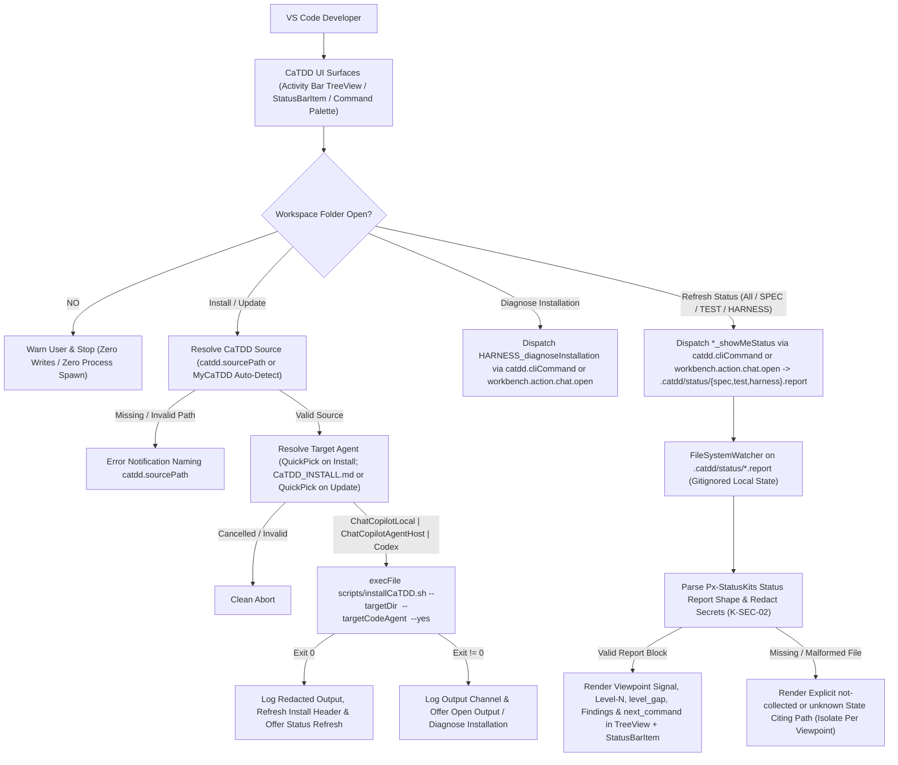

# CaTDD VS Code Extension v0.1 Walking Skeleton (`plugExtentions/VSCode`)

> **Story ID:** US-vscodeDeveloper-manageCatddAndViewStatusInVscode | **State:** todo | **Priority:** P0
> **StoryIdAlias:** US-261115.105903
> **CreatedAt:** 2026-11-15T10:59:03+08:00
> **Source:** `.catdd/spec/analyzedNews/20261115-plugExtentions-VSCode-v0.1-Feature.md`
> **CaTDD Class:** P0 Functional
> **Primary Category:** Typical

---

## Story Statement

**As a** VS Code developer working in a CaTDD target or source repository,
**I want** a thin `v0.1` CaTDD VS Code extension (`plugExtentions/VSCode`) with an Activity Bar `TreeView`, `StatusBarItem`, and Command Palette commands that install and refresh CaTDD via `scripts/installCaTDD.sh`, trigger `HARNESS_diagnoseInstallation` and `SPEC`/`TEST`/`HARNESS` status checks via Copilot Chat or a configured CLI command, and render watched `.catdd/status/*.report` `Status Report Shape` snapshots,
**So that** I can onboard, update, diagnose, and inspect `SPEC`, `TEST`, and `HARNESS` status directly inside VS Code without re-implementing CaTDD method semantics or memorizing shell flags and slash-command syntax.

---

## Story Readiness Snapshot

| Lens | EPIC Dimension | Answer | Evidence |
| --- | --- | --- | --- |
| User value & behavioral scope are explicit | `C1 Scope Discipline` | yes | Thin VS Code extension walking skeleton (`plugExtentions/VSCode:v0.1`) covering `install/update/diagnose` + `SPEC/TEST/HARNESS` status display, confirmed in `BRAINSTORM` Q1–Q7 |
| Observable & measurable outcome exists | `E1 Unambiguous` + `E3 Verifiable` | yes | Activity Bar `TreeView`, `StatusBarItem`, Command Palette commands, `execFile` invocation of `scripts/installCaTDD.sh`, Chat/CLI dispatch, and watched `.catdd/status/*.report` `Status Report Shape` rendering |
| Concrete examples & exceptional paths exist | `E2 Singular` + `P2 Complete` | yes | 9 atomic P0 CaTDD-ACs across `Typical` (3), `Edge` (2), `Misuse` (2), and `Fault` (2) backed by `EX-01..EX-05` and `CEX-01..CEX-04` |
| Every AC has source-backed evidence | `E3 Verifiable` + `I2 Consistent` | yes | Every `From` cites at least one `EX-*`/`CEX-*` and `RULE-*` grounded in `plugExtentions/VSCode/README.md`, `Px-StatusKits.md`, `installCaTDD.sh`, and developer `BRAINSTORM` decisions |
| Dependencies, assumptions & risks are declared | `P1 Dependency Control` | yes | Explicit handling of VS Code `workbench.action.chat.open` one-way constraint via watched `.catdd/status/*.report` files, `catdd.sourcePath` resolution, and design-only status of `specCodeAgentCLI` |
| Story-specific completion conditions are stated | `E3.4 Completion & Readiness` | yes | `## Story Completion Conditions` requires runnable TS extension + SPEC/design docs + P0 CaTDD tests passing at `mockSysRtm` (`testPassOnMock`) |
| Template structure & stable IDs are preserved | `I1 Conforming` | yes | Registered `US-vscodeDeveloper-manageCatddAndViewStatusInVscode` / `US-261115.105903` in `README_UserStories.md` and qualified `US-261115.105903-AC-*` IDs |
| Blocking questions remain | `E1.1 Clarification-Seeking` | no | All 7 `Initial Acceptance Questions` resolved across 2 interactive `BRAINSTORM` rounds |
| Story size is acceptable | `E2 Singular` + `C1 Scope Discipline` | yes | Bounded `v0.1` thin-UI walking skeleton (zero duplicated CaTDD grading logic; multi-command diagnosis pickers, Webviews, and `.vsix` asset bundling deferred) |
| Ready decision | Stage 1 Sufficiency Gate | Ready | All blocking questions answered and registered in `README_UserStories.md`; ready for `SPEC_openUserStory` |

---

## Priority

| Dimension | Score (1-9) | Rationale |
| --- | --- | --- |
| Business Value | 8 | Establishes the first IDE plugin surface (`plugExtentions/VSCode`) turning `Px-StatusKits` and `installCaTDD.sh` into a visible product entry point. |
| User Value | 9 | Gives developers one-click CaTDD install/refresh/diagnose and persistent `SPEC`/`TEST`/`HARNESS` status visibility inside VS Code. |
| Cost / Effort | 4 | Runnable TypeScript VS Code extension scaffold (`TreeView`, `StatusBarItem`, commands, watcher, parser) plus P0 `mockSysRtm` tests and SPEC docs. |
| Risk / Complexity | 3 | Thin-UI architecture delegates semantic status/diagnosis to Chat/CLI and installation to `scripts/installCaTDD.sh`, avoiding duplicated CaTDD logic. |

**Priority Score:** (8 + 9) / (4 + 3) = **2.43** | **Priority:** P0

---

## Example Mapping

| Card | ID | Content | Trace / Decision |
| --- | --- | --- | --- |
| Yellow Story | `US-vscodeDeveloper-manageCatddAndViewStatusInVscode` | CaTDD VS Code Extension `v0.1` walking skeleton (`install/update/diagnose` + `SPEC/TEST/HARNESS` status) | Analyzed feature `plugExtentions/VSCode:v0.1` |
| Blue Rule | `RULE-01` | `CaTDD: Install` prompts via QuickPick for `targetCodeAgent` (`ChatCopilotLocal` \| `ChatCopilotAgentHost` \| `Codex`) and invokes `scripts/installCaTDD.sh --targetDir <workspaceRoot> --targetCodeAgent <agent> --yes`; `CaTDD: Update` reuses the target agent recorded in `.catdd/CaTDD_INSTALL.md` (falling back to QuickPick when absent). | `AC-Typical-01`, `AC-Misuse-01`, `AC-Misuse-02`, `AC-Fault-01` |
| Blue Rule | `RULE-02` | Keep directory path `plugExtentions/VSCode` exact; resolve the CaTDD source repository from `catdd.sourcePath` setting first, auto-detecting the open workspace root when `catdd.sourcePath` is unset and the workspace contains `scripts/installCaTDD.sh`, `methodPrompts/`, and `slashCommands/`. | `AC-Typical-01`, `AC-Edge-01`, `AC-Misuse-01` |
| Blue Rule | `RULE-03` | `plugExtentions/VSCode` is a thin UI wrapper: `CaTDD: Refresh Status` dispatches `SPEC_showMeStatus`, `TEST_showMeStatus`, and/or `HARNESS_showMeStatus` via configured `catdd.cliCommand` (when set) or Copilot Chat (`workbench.action.chat.open`) instructing output to `.catdd/status/{spec,test,harness}.report` instead of re-implementing CaTDD grading semantics locally. | `AC-Typical-02`, `AC-Fault-02` |
| Blue Rule | `RULE-04` | A `FileSystemWatcher` on `.catdd/status/*.report` parses the canonical `Px-StatusKits` `Status Report Shape` (`viewpoint`, `status_signal`, `maturity_level` / `completeness_level` / `integrity_level`, `level_evidence`, `level_gap`, `findings`, `next_command`) into the CaTDD Sidebar `TreeView` (`SPEC`, `TEST`, `HARNESS` sections) and `StatusBarItem`, rendering explicit `not-installed` / `not-collected` / `unknown` states when files are absent or malformed. | `AC-Typical-02`, `AC-Edge-01`, `AC-Fault-02` |
| Blue Rule | `RULE-05` | `CaTDD: Diagnose Installation` maps to the single `HARNESS_diagnoseInstallation` action delegated to configured `catdd.cliCommand` or Copilot Chat (`workbench.action.chat.open`), never mutating `.catdd/` files directly from the extension. | `AC-Typical-03`, `AC-Fault-01` |
| Blue Rule | `RULE-06` | `.catdd/status/` snapshot files are local runtime work state (gitignored like `WorkingProcessLog.md`) and `MUST` never be treated as team-shared repository truth. | `AC-Edge-02` |
| Blue Rule | `RULE-07` | Constitutional security invariants `K-SEC-01..04` hold: subprocesses `MUST` run via `execFile` argv arrays without shell interpolation, path traversal is rejected, and `ApiKEY` / token patterns are redacted before rendering in Output or `TreeView`. | `AC-Edge-02`, `AC-Misuse-02` |
| Green Example | `EX-01` | Developer opens `~/work/acme-pay` with `catdd.sourcePath = /Users/dev/MyCaTDD`, runs `CaTDD: Install`, picks `Codex`, and the extension runs `/Users/dev/MyCaTDD/scripts/installCaTDD.sh --targetDir ~/work/acme-pay --targetCodeAgent Codex --yes` with exit `0`. | `AC-Typical-01` |
| Green Example | `EX-02` | Developer opens an already-installed workspace containing `.catdd/CaTDD_INSTALL.md` (`Target agent: ChatCopilotLocal`) and clicks `Update`; extension reads `ChatCopilotLocal` and runs `installCaTDD.sh --targetDir <ws> --targetCodeAgent ChatCopilotLocal --yes`. | `AC-Typical-01` |
| Green Example | `EX-03` | Developer clicks `Refresh Status` in the CaTDD Activity Bar; extension dispatches `SPEC_showMeStatus`, `TEST_showMeStatus`, and `HARNESS_showMeStatus` targeting `.catdd/status/{spec,test,harness}.report`, and when those files write `Status Report Shape` blocks, `TreeView` displays `SPEC: Level-1 (Spec-First) [attention]`, `UT: Level-1 (Sketched) [attention]`, `HARNESS: Level-1 (Present) [attention]` with `level_gap`, `findings`, and `next_command`, while `StatusBarItem` updates to `CaTDD: S:L1 T:L1 H:L1 (attention)`. | `AC-Typical-02`, `AC-Edge-02` |
| Green Example | `EX-04` | Developer clicks `Diagnose Installation`; extension opens Copilot Chat via `workbench.action.chat.open` with `/HARNESS_diagnoseInstallation` scoped to the workspace root. | `AC-Typical-03` |
| Green Example | `EX-05` | Developer opens `MyCaTDD` itself with `catdd.sourcePath` left blank and no `.catdd/status/*.report` files yet; extension auto-detects `MyCaTDD` as the CaTDD source root and displays `not-collected` status placeholders with clickable `Refresh Status`, `Update`, and `Diagnose` actions. | `AC-Edge-01` |
| Green Counter-Example | `CEX-01` | Developer invokes `CaTDD: Install` with no folder open in VS Code (or cancels QuickPick, or `catdd.sourcePath` is empty in an external repo); extension shows a warning/error notification and spawns zero processes. | `AC-Misuse-01` |
| Green Counter-Example | `CEX-02` | `catdd.sourcePath` is set to `/tmp/bad; rm -rf /` or `../../nonexistent` or an invalid agent value `EvilAgent` is passed; validator rejects it before `execFile` is called. | `AC-Misuse-02` |
| Green Counter-Example | `CEX-03` | `scripts/installCaTDD.sh` exits with code `1` due to an unreadable target manifest; extension logs `stderr` to Output Channel, pops an error notification with `Open Output` + `Diagnose Installation`, and does not claim install succeeded. | `AC-Fault-01` |
| Green Counter-Example | `CEX-04` | `.catdd/status/spec.report` contains truncated text missing `maturity_level:` and `status_signal:`; parser marks `SPEC` node `status_signal: unknown` citing `.catdd/status/spec.report` while `TEST` and `HARNESS` nodes still render their valid reports. | `AC-Fault-02` |

**Example Mapping Decision:** Ready

---

## Visual Model

### Model Gap Analysis

| # | Gap Found | Question |
| --- | --- | --- |
| 1 | VS Code `workbench.action.chat.open` does not return Chat reply text to extensions, and `specCodeAgentCLI` is design-only — how do `TreeView` and `StatusBarItem` receive `SPEC/TEST/HARNESS` status? | Resolved in `BRAINSTORM` Q5: trigger `*_showMeStatus` via Chat or `catdd.cliCommand` to write gitignored `.catdd/status/*.report` snapshot files, and watch/parse `Status Report Shape` into `TreeView` + `StatusBarItem`. |
| 2 | Which exact scripts and `HARNESS_*` commands back `install`, `update`, and `diagnose` in `v0.1`? | Resolved in `BRAINSTORM` Q6: `Install`/`Update` invoke `scripts/installCaTDD.sh --yes` (with target agent selection/reuse), and `Diagnose` invokes the single `HARNESS_diagnoseInstallation` action via Chat/CLI. |
| 3 | How does `installCaTDD.sh` find `MyCaTDD` when the developer is working in an external target repo? | Resolved in `BRAINSTORM` Q4: read `catdd.sourcePath` workspace/user setting, auto-detecting the open workspace when it is `MyCaTDD` itself. |

---

## Input and Output Dictionary

| Element | Kind | Type / Format | Required | Allowed Values / Limits | Producer | Consumer | Validation / Question |
| --- | --- | --- | --- | --- | --- | --- | --- |
| `workspaceRoot` | input (context) | absolute directory path | yes | First/selected open VS Code `WorkspaceFolder` | VS Code Workspace | `plugExtentions/VSCode` | Missing workspace -> abort before action |
| `catdd.sourcePath` | input (setting) | filesystem directory path | conditional | Directory containing executable `scripts/installCaTDD.sh`, `methodPrompts/`, `slashCommands/`; optional when open workspace is `MyCaTDD` | Developer / VS Code Settings | Installer runner | Non-directory, traversal escape, or missing `installCaTDD.sh` -> reject |
| `catdd.cliCommand` | input (setting) | executable path / argv prefix | no | Optional local CLI runner command; empty defaults to Copilot Chat (`workbench.action.chat.open`) | Developer / VS Code Settings | Chat/CLI dispatcher | Empty -> Chat dispatch; failed execution -> `unknown` / error diagnostic |
| `targetCodeAgent` | input (selection / file) | enum string | yes for `Install`/`Update` | `ChatCopilotLocal` \| `ChatCopilotAgentHost` \| `Codex` | QuickPick or `.catdd/CaTDD_INSTALL.md` | `scripts/installCaTDD.sh` | Any value outside enum -> reject before `execFile` |
| `.catdd/status/{spec,test,harness}.report` | input/output (local file) | UTF-8 text (`Status Report Shape`) | no | Gitignored local snapshot files matching `Px-StatusKits` `Status Report Shape` (`viewpoint`, `status_signal`, `*_level`, `level_evidence`, `level_gap`, `findings`, `next_command`) | Copilot Chat / CLI command | `FileSystemWatcher` & `StatusReportParser` | Missing -> `not-collected`; malformed -> `status_signal: unknown` |
| `CaTDD Sidebar TreeView` | output (UI) | VS Code `TreeDataProvider` | yes | Root groups: Installation summary + `SPEC`, `TEST` (`UT`), `HARNESS` viewpoints with signal icon, `Level-N`, `level_gap`, `findings`, `next_command`, and inline commands | `plugExtentions/VSCode` | Developer | Redacts secrets (`K-SEC-02`); isolates per-viewpoint parse errors |
| `CaTDD StatusBarItem` | output (UI) | VS Code `StatusBarItem` | yes | Compact summary of `SPEC`/`TEST`/`HARNESS` levels + worst `status_signal` (or `not-installed` / `not-collected`); click focuses CaTDD view or refreshes | `plugExtentions/VSCode` | Developer | Updates deterministically on snapshot or install change |
| `CaTDD Output Channel` | output (log) | VS Code `OutputChannel` | yes | Redacted command invocations, `installCaTDD.sh` `stdout`/`stderr`, and parser/dispatch diagnostics | `plugExtentions/VSCode` | Developer | Never prints cleartext `ApiKEY` / secret tokens (`K-SEC-02`) |

---

## CaTDD-AC - P0-Functional (`MUST`)

### Typical (ValidFunc)

#### US-261115.105903-AC-Typical-01: Install and Update CaTDD via `scripts/installCaTDD.sh`

- **FROM**
  - **Example:** `EX-01`, `EX-02`
  - **Rule:** `RULE-01`, `RULE-02`
- **GIVEN**
  - A VS Code workspace folder is open
  - **AND** a valid CaTDD source directory is resolved from `catdd.sourcePath` (or auto-detected from the open `MyCaTDD` workspace)
- **WHEN**
  - The developer invokes `CaTDD: Install` (selecting `ChatCopilotLocal`, `ChatCopilotAgentHost`, or `Codex` in QuickPick) or invokes `CaTDD: Update` (reusing the `Target agent` recorded in `.catdd/CaTDD_INSTALL.md`, or prompting via QuickPick if absent)
- **THEN**
  - The extension `MUST` execute `<sourceRoot>/scripts/installCaTDD.sh --targetDir <workspaceRoot> --targetCodeAgent <agent> --yes` via `execFile`, stream redacted output to the `CaTDD` Output Channel, refresh the installation header in `TreeView` and `StatusBarItem` upon exit `0`, and `MUST` ensure `.catdd/status/` is ignored in local gitignore state or excluded from tracked changes.
- **COUNTER**
  - When no workspace is open or QuickPick is cancelled, the extension `MUST NOT` invoke `scripts/installCaTDD.sh`.

**Open Questions:** None

#### US-261115.105903-AC-Typical-02: Dispatch `SPEC` / `TEST` / `HARNESS` Status to Chat/CLI and Render Watched Snapshots

- **FROM**
  - **Example:** `EX-03`
  - **Rule:** `RULE-03`, `RULE-04`
- **GIVEN**
  - A VS Code workspace folder is open with the `CaTDD` Activity Bar `TreeView` and `StatusBarItem` registered
- **WHEN**
  - The developer invokes `CaTDD: Refresh Status` (for all viewpoints or a selected `SPEC` / `TEST` / `HARNESS` viewpoint) and `.catdd/status/{spec,test,harness}.report` files are created or updated in `Px-StatusKits` `Status Report Shape`
- **THEN**
  - The extension `MUST` dispatch `SPEC_showMeStatus`, `TEST_showMeStatus`, and/or `HARNESS_showMeStatus` via configured `catdd.cliCommand` or Copilot Chat (`workbench.action.chat.open`) instructing snapshot output to `.catdd/status/{spec,test,harness}.report`, `MUST` detect file updates via `FileSystemWatcher`, and `MUST` parse and display each viewpoint's `status_signal`, graded level (`maturity_level`, `completeness_level`, `integrity_level`), `level_evidence`, `level_gap`, `findings`, and `next_command` in `TreeView` plus the aggregate summary in `StatusBarItem` without re-implementing CaTDD grading rules locally.
- **COUNTER**
  - Computing synthetic `maturity_level` / `completeness_level` / `integrity_level` grades directly from ad hoc heuristics in extension code instead of parsing `Status Report Shape` snapshots `MUST NOT` occur.

**Open Questions:** None

#### US-261115.105903-AC-Typical-03: Trigger Single `HARNESS_diagnoseInstallation` Action via Chat or CLI

- **FROM**
  - **Example:** `EX-04`
  - **Rule:** `RULE-05`
- **GIVEN**
  - A VS Code workspace folder is open
- **WHEN**
  - The developer invokes `CaTDD: Diagnose Installation` from the `TreeView`, `StatusBarItem` action flow, error notification button, or Command Palette
- **THEN**
  - The extension `MUST` dispatch the single `HARNESS_diagnoseInstallation` prompt/command via configured `catdd.cliCommand` (when set) or Copilot Chat (`workbench.action.chat.open`) targeting the open workspace root (and passing resolved `source_root` when known), and `MUST NOT` mutate `.catdd/` or workspace files directly during diagnosis dispatch.
- **COUNTER**
  - Directly overwriting or deleting `.catdd/` files during `Diagnose Installation` `MUST NOT` occur.

**Open Questions:** None

### Edge (ValidFunc)

#### US-261115.105903-AC-Edge-01: Uninitialized Workspace Cold Start, Partial Snapshots, and `MyCaTDD` Source Auto-Detection

- **FROM**
  - **Example:** `EX-05`
  - **Rule:** `RULE-02`, `RULE-04`
- **GIVEN**
  - A readable workspace has no `.catdd/CaTDD_INSTALL.md` and/or zero or only a subset of `.catdd/status/{spec,test,harness}.report` files
  - **AND** optionally `catdd.sourcePath` is empty while the open workspace itself contains `scripts/installCaTDD.sh`, `methodPrompts/`, and `slashCommands/`
- **WHEN**
  - The extension activates or refreshes its UI state
- **THEN**
  - The extension `MUST` render explicit `not-installed` (when `.catdd/CaTDD_INSTALL.md` is absent) and `not-collected` (for any viewpoint without a `.catdd/status/*.report` snapshot) states in `TreeView` and `StatusBarItem` without fabricating `healthy` or `Level-1+`, and `MUST` auto-detect the open `MyCaTDD` workspace as the valid CaTDD source root when `catdd.sourcePath` is unset.
- **COUNTER**
  - In an external workspace lacking `scripts/installCaTDD.sh`, `methodPrompts/`, and `slashCommands/`, leaving `catdd.sourcePath` empty `MUST NOT` guess an arbitrary filesystem path.

#### US-261115.105903-AC-Edge-02: Local Snapshot Gitignore Hygiene and Credential Redaction (`K-SEC-02`)

- **FROM**
  - **Example:** `EX-03`
  - **Rule:** `RULE-06`, `RULE-07`
- **GIVEN**
  - Status snapshots are stored under `.catdd/status/` and CLI/installer outputs or report text may contain sensitive credentials (`ApiKEY`, bearer tokens, secret env values)
- **WHEN**
  - The extension constructs status-snapshot prompts, ensures local ignore rules, or renders text in `TreeView`, notifications, and the `CaTDD` Output Channel
- **THEN**
  - The extension `MUST` treat `.catdd/status/` strictly as local gitignored runtime state (ensuring `.catdd/status/` is covered in `.gitignore` or `.git/info/exclude` during install/snapshot setup without treating snapshots as team-shared truth) and `MUST` mask/redact credential patterns (`ApiKEY`, `sk-*`, `ghp_*`, `Bearer *`, secret key-value pairs) across all logs and UI labels (`K-SEC-02`).
- **COUNTER**
  - Non-secret file paths, `StoryIdAlias` tokens, commit hashes, and `Level-N` strings `MUST` remain uncorrupted by redaction.

### Misuse (InvalidFunc)

#### US-261115.105903-AC-Misuse-01: Missing Workspace, Cancelled QuickPick, or Unset External `catdd.sourcePath` Cleanly Aborted

- **FROM**
  - **Example:** `CEX-01`
  - **Rule:** `RULE-01`, `RULE-02`
- **GIVEN**
  - Zero workspace folders are open in VS Code, OR the user dismisses the `targetCodeAgent` QuickPick, OR `Install`/`Update` is invoked in a non-`MyCaTDD` workspace with `catdd.sourcePath` unset
- **WHEN**
  - A CaTDD extension command is invoked
- **THEN**
  - The extension `MUST` stop immediately before spawning any child process or mutating any file, and (except on intentional QuickPick Escape cancellation, which exits silently) `MUST` surface an actionable warning/error message naming the missing workspace folder or `catdd.sourcePath` setting.
- **COUNTER**
  - When a workspace is open, a valid source root resolves, and a valid agent is chosen, `Install`/`Update` proceeds normally.

#### US-261115.105903-AC-Misuse-02: Path Traversal, Non-Directory Source Path, or Invalid Agent Token Rejected (`K-SEC-01`)

- **FROM**
  - **Example:** `CEX-02`
  - **Rule:** `RULE-01`, `RULE-07`
- **GIVEN**
  - `catdd.sourcePath` points to a non-existent/non-directory path, a snapshot path escapes `<workspaceRoot>/.catdd/status/`, or a programmatic command call passes an unsupported `targetCodeAgent` outside `{ChatCopilotLocal, ChatCopilotAgentHost, Codex}`
- **WHEN**
  - Input boundary validation runs before subprocess execution or file read
- **THEN**
  - The extension `MUST` reject the operation before invoking any subprocess or reading outside `<workspaceRoot>/.catdd/status/`, `MUST` execute external binaries exclusively via `execFile` argument arrays (never `exec` shell string concatenation — `K-SEC-01` / `CWE-78` / `CWE-22`), and `MUST` record a diagnostic error.
- **COUNTER**
  - Canonical existing directory paths and the three supported `targetCodeAgent` values pass validation.

### Fault (InvalidFunc)

#### US-261115.105903-AC-Fault-01: Missing `installCaTDD.sh` or Non-Zero Installer Exit Handled Deterministically

- **FROM**
  - **Example:** `CEX-03`
  - **Rule:** `RULE-01`, `RULE-05`
- **GIVEN**
  - Valid workspace and agent inputs, while `<sourceRoot>/scripts/installCaTDD.sh` is missing/non-executable or exits with a non-zero exit code (or times out / errors)
- **WHEN**
  - `CaTDD: Install` or `CaTDD: Update` executes
- **THEN**
  - The extension `MUST` record the redacted `stdout`/`stderr` and exit code in the `CaTDD` Output Channel, `MUST` display an error notification offering `Open Output` and `Diagnose Installation` (`HARNESS_diagnoseInstallation`), and `MUST NOT` overwrite prior valid `.catdd/status/*.report` snapshots or report installation success.
- **COUNTER**
  - When `scripts/installCaTDD.sh` exits `0`, the extension reports completion and refreshes the installed header state.

#### US-261115.105903-AC-Fault-02: Malformed Status Snapshot or Chat/CLI Dispatch Failure Isolated Per Viewpoint

- **FROM**
  - **Example:** `CEX-04`
  - **Rule:** `RULE-03`, `RULE-04`
- **GIVEN**
  - One watched `.catdd/status/{spec,test,harness}.report` file is unreadable, empty, or malformed (missing required `viewpoint`, `status_signal`, or `*_level` fields), OR dispatching `workbench.action.chat.open` / `catdd.cliCommand` rejects with an error
- **WHEN**
  - The snapshot parser or command dispatcher runs
- **THEN**
  - The extension `MUST` catch and log the error to the `CaTDD` Output Channel, `MUST` degrade the affected viewpoint to `status_signal: unknown` (with a finding citing the unreadable/malformed report path or dispatch error), and `MUST` keep the other viewpoints, `StatusBarItem`, and VS Code extension host responsive without uncaught exceptions.
- **COUNTER**
  - Valid `Status Report Shape` files for unaffected viewpoints continue displaying their parsed levels and findings.

TP/TC references are not definitions. Reconcile each TP's owning AC and covering TC rather than inferring links from numeric suffixes; authoritative TP definitions and links stay in verification design.

---

## Business Rules

| ID | Rule | Type | Implied Functional Requirement |
| --- | --- | --- | --- |
| `BR-01` | `plugExtentions/VSCode` is a thin UI adapter over `scripts/installCaTDD.sh` and `slashCommands/` (`Px-StatusKits` & `Px-HarnessKits`), never a second source of CaTDD method or grading semantics. | Constraint | Delegate status computation and installation diagnosis to Chat/CLI (`*_showMeStatus`, `HARNESS_diagnoseInstallation`) and parse `Status Report Shape` outputs rather than duplicating grading logic. |
| `BR-02` | Each viewpoint (`SPEC`, `UT`/`TEST`, `HARNESS`) has one canonical `status_signal` (`healthy` \| `attention` \| `blocked` \| `unknown`) and one `Level-0..Level-5` field (`maturity_level`, `completeness_level`, `integrity_level`). | Fact | `StatusReportParser`, `TreeView`, and `StatusBarItem` must preserve exact viewpoint level names and signals from `Px-StatusKits`. |
| `BR-03` | An unreadable or malformed report is `unknown`, whereas a readable workspace with no report collected yet is `not-collected` and no `.catdd/CaTDD_INSTALL.md` is `not-installed`. | Inference | Distinguish `not-installed`, `not-collected`, and `unknown` in UI state instead of collapsing them into `healthy` or crashing. |
| `BR-04` | `.catdd/status/*.report` files are local machine/session snapshots, not team-shared SpecCoding truth. | Constraint | Keep `.catdd/status/` gitignored alongside `WorkingProcessLog.md` so status refreshes never dirty `git status` with tracked files. |
| `BR-05` | Canonical folder spelling for the IDE plugin layer in `MyCaTDD` is `plugExtentions/VSCode`. | Fact | Register `plugExtentions/VSCode/` across `projectContext.md`, README/design docs, package metadata, and repository structure checks. |
| `BR-06` | Constitutional invariants `K-SEC-01..04` apply to all extension subprocesses, file watchers, and UI outputs. | Constraint | Use `execFile` argv arrays, enforce path containment, redact credentials, and assert deterministic non-vacuous test oracles. |

**Business Rule Decision:** all rules explicit

---

## Sub-UserStory Candidates

| Candidate | CaTDD Class / Category | Why It Is Not In Main AC | Recommendation | Status |
| --- | --- | --- | --- | --- |
| Multi-command Harness diagnostics picker (`HARNESS_verifyInstallation`, `HARNESS_diagnoseProject`, `HARNESS_migrateMetaspec`, `HARNESS_evolveHarness`) | `P0 Functional` / `P1 Capability` | Developer scoped `v0.1` `Diagnose` to the single `HARNESS_diagnoseInstallation` action (`BRAINSTORM` Q6) | Defer to `v0.2` follow-up story | deferred |
| Rich Webview visual dashboard & interactive lane/TC drill-down | `P1 Design` / `Interaction` | Developer selected native Sidebar `TreeView` + `StatusBarItem` + Commands for `v0.1` (`BRAINSTORM` Q3) | Defer to `v0.2+` UX story | deferred |
| Bundled CaTDD assets inside packaged `.vsix` & VS Code Marketplace publishing | `P2 Compatibility` / `Configuration` | Developer selected `catdd.sourcePath` setting + `MyCaTDD` auto-detection for `v0.1` (`BRAINSTORM` Q4) | Defer to packaging/release story | deferred |
| Direct `specCodeAgentCLI --json` integration once `specCodeAgentCLI` runtime ships | `P1 Interaction` | `specCodeAgentCLI` is currently design-only; `v0.1` supports generic `catdd.cliCommand` + Copilot Chat snapshot bridge (`BRAINSTORM` Q5) | Defer until `specCodeAgentCLI` runnable story closes | deferred |
| Bilingual `_ZH` user/design documentation mirrors under `plugExtentions/` | Documentation mirror | Keep `v0.1` walking skeleton focused; align `_ZH` mirrors where required by `scripts/check_readme_mirror.sh` or follow-up doc slice | Verify repo mirror check during design/review; defer optional standalone guides | deferred |

**Split Decision:** keep as one cohesive `v0.1` thin-UI walking-skeleton story; advanced diagnostics, Webview dashboard, and `.vsix` bundling remain follow-up stories after `v0.1`.

---

## Scope

### In scope

- Keep canonical path `plugExtentions/VSCode/` and update `.catdd/spec/projectContext.md` (`## Layer Model`) plus `plugExtentions/` documentation (`README.md`, `README_UserGuide.md`, design & verification docs as planned in `SPEC_makePlan`).
- Build runnable TypeScript VS Code extension walking skeleton under `plugExtentions/VSCode/` providing:
  - Activity Bar container & `TreeView` (`Installation` header + `SPEC`, `TEST`, `HARNESS` status sections + inline actions)
  - `StatusBarItem` aggregate summary badge
  - Command Palette commands: `CaTDD: Install`, `CaTDD: Update`, `CaTDD: Diagnose Installation`, `CaTDD: Refresh Status` (all & per-viewpoint), and `CaTDD: Open Output`
  - `scripts/installCaTDD.sh` `execFile` runner with `catdd.sourcePath` + `MyCaTDD` auto-detection and `ChatCopilotLocal` / `ChatCopilotAgentHost` / `Codex` selection/reuse
  - Copilot Chat (`workbench.action.chat.open`) / `catdd.cliCommand` dispatcher for `SPEC_showMeStatus`, `TEST_showMeStatus`, `HARNESS_showMeStatus`, and `HARNESS_diagnoseInstallation`
  - `FileSystemWatcher` + `StatusReportParser` over gitignored `.catdd/status/{spec,test,harness}.report` files with `K-SEC-02` secret redaction
- Design and implement P0 CaTDD tests (`Typical`, `Edge`, `Misuse`, `Fault`) for `plugExtentions/VSCode` passing at `mockSysRtm` (`testPassOnMock`).

### Non-goals

- Re-implementing `SPEC_showMeStatus`, `TEST_showMeStatus`, `HARNESS_showMeStatus`, or `HARNESS_diagnoseInstallation` semantic evaluation rules in TypeScript inside the extension.
- Shipping a custom HTML/CSS Webview dashboard in `v0.1`.
- Bundling `methodPrompts/` and `slashCommands/` copies inside a Marketplace `.vsix` archive in `v0.1`.
- Implementing the runnable `codeAgents/specCodeAgentCLI/` binary inside this story.

---

## Story Completion Conditions (`EPIC E3.4`)

| Completion Dimension | Requirement (`MUST` hold before `SPEC_closeUserStory`) |
| --- | --- |
| **Required `TestLevel`** | `UnitTesting` + `SysTesting` across extension core modules (`sourceResolver`, `installerRunner`, `statusDispatcher`, `statusReportParser`, `treeAndStatusBarController`, and command wiring) plus repository validation scripts (`scripts/check_readme_mirror.sh`, `scripts/test_documentation_contract.sh`) |
| **Required `TestScope` & Environment** | `mockSysRtm` (`testPassOnMock`) `CLOSED` across all in-scope P0 TCs using deterministic VS Code host/process/filesystem doubles (`realSysRtm` interactive VS Code Extension Development Host smoke steps documented in `README_UserGuide.md`, optional for CI closure) |
| **Required CaTDD Categories** | Mandatory `P0 Functional` set: `Typical`, `Edge`, `Misuse`, and `Fault` covering all 9 `US-261115.105903-AC-*` acceptance criteria with `discovery_status: PASS` and `ready_for_implementation: yes` |
| **Required SPEC & Doc Surfaces** | `README_UserStories.md`, `.catdd/spec/projectContext.md`, `plugExtentions/README.md`, `plugExtentions/VSCode/README.md`, `plugExtentions/VSCode/README_UserGuide.md`, `plugExtentions/VSCode/README_ArchDesign.md`, `plugExtentions/VSCode/README_DetailDesign.md`, `plugExtentions/VSCode/README_DetailVerifyDesign.md`, `.gitignore` (for `.catdd/status/`), and companion test `*_readme.md` files as required |
| **Not-Done Conditions (`MUST NOT close if`)** | TypeScript build fails, any of the 9 P0 CaTDD-ACs lacks a `CLOSED` (`testPassOnMock`) TC, extension re-implements grading heuristics instead of parsing `Status Report Shape`, `exec` shell interpolation is used (`K-SEC-01`), secrets leak unredacted (`K-SEC-02`), `.catdd/status/` is not gitignored, repository contract scripts fail, or developer-approved commits are missing |
| **Approved Deferrals** | Multi-command `HARNESS_*` diagnosis picker, Webview dashboard, `.vsix` bundled CaTDD assets, Marketplace publishing, and direct `specCodeAgentCLI` runtime implementation |

---

## Risks & Assumptions

| # | Risk / Assumption | Severity | Mitigation / Clarification Needed |
| --- | --- | --- | --- |
| 1 | VS Code `workbench.action.chat.open` is fire-and-forget and depends on the active Chat agent writing `.catdd/status/*.report` in `Status Report Shape`. | Medium | Construct explicit, copy-accurate prompt instructions specifying the target `.catdd/status/<viewpoint>.report` path and `Status Report Shape` contract, support `catdd.cliCommand` for deterministic CLI execution, and handle partial/malformed output gracefully (`AC-Fault-02`). |
| 2 | `.catdd/status/*.report` files could accidentally show up as untracked files in target repositories. | Medium | Add `/.catdd/status/` to repository `.gitignore` and ensure local ignore hygiene so status snapshots stay untracked local runtime state (`AC-Edge-02`). |
| 3 | Importing `vscode` module directly inside core logic would block fast headless Node/TS `mockSysRtm` unit testing. | Medium | Isolate VS Code API behind a thin host adapter interface in `ArchDesign` / `DetailDesign` so all P0 `Typical`/`Edge`/`Misuse`/`Fault` tests run deterministically at `mockSysRtm` (`testPassOnMock`) without requiring a GUI Electron instance. |
| 4 | Adding `plugExtentions/` READMEs without checking mirror scripts could trip `scripts/check_readme_mirror.sh` or `scripts/test_documentation_contract.sh`. | Low | Inspect and satisfy repository README/mirror contract checks before closure. |

---

## Initial Acceptance Questions

| # | Question | Raised By | Blocks Ready? | Owner / Next Evidence | Status |
| --- | --- | --- | --- | --- | --- |
| 1 | Should `plugExtentions/VSCode:v0.1` be split into multiple stories, start design-only, or stay one `v0.1` walking-skeleton story? | Step 1 Feature Tree | yes | Developer (`BRAINSTORM` Q1) | answered: Single `v0.1` walking-skeleton story |
| 2 | Should `STATUS` and `diagnose` parse repository files locally in TS or act as a thin UI delegating to Chat / CLI? | Step 2 & Step 4 Architecture boundary | yes | Developer (`BRAINSTORM` Q2) | answered: Thin UI delegating to Chat / CLI |
| 3 | Which VS Code UI surfaces should `v0.1` expose? | Step 3 Scenario discovery | yes | Developer (`BRAINSTORM` Q3) | answered: Sidebar `TreeView` + `StatusBarItem` + Command Palette commands |
| 4 | Should `plugExtentions/VSCode` keep its spelling and how should `MyCaTDD` source assets be located? | Step 5 & Step 7 Naming/dependency check | yes | Developer (`BRAINSTORM` Q4) | answered: Keep `plugExtentions/VSCode` spelling; resolve via `catdd.sourcePath` setting with `MyCaTDD` workspace auto-detect |
| 5 | Given `workbench.action.chat.open` is one-way and `specCodeAgentCLI` is design-only, how do `TreeView` and `StatusBarItem` receive `SPEC/TEST/HARNESS` status data? | Step 4 Model Gap #1 | yes | Developer (`BRAINSTORM` Q5) | answered: Trigger `*_showMeStatus` in Chat / `catdd.cliCommand` to write gitignored `.catdd/status/*.report` snapshot files; watch & parse `Status Report Shape` |
| 6 | Which exact scripts and `HARNESS_*` commands back `install`, `update`, and `diagnose` in `v0.1`? | Step 4 Model Gap #2 | yes | Developer (`BRAINSTORM` Q6) | answered: `scripts/installCaTDD.sh --yes` for `Install`/`Update` + single `HARNESS_diagnoseInstallation` action via Chat/CLI for `Diagnose` |
| 7 | Does this single `v0.1` story deliver runnable TypeScript extension code + P0 tests or design docs only? | Step 9 `EPIC E3.4` Completion gate | yes | Developer (`BRAINSTORM` Q7) | answered: Runnable TS VS Code extension + SPEC/design docs + P0 CaTDD tests passing on `mockSysRtm` |

**Gate:** This story is READY for `SPEC_openUserStory` — all 7 blocking acceptance questions are answered and recorded in `.catdd/spec/analyzedNews/20261115-plugExtentions-VSCode-v0.1-Feature.md`.

---

## Ambiguity Warnings

| # | Smell Code | Ambiguous Term / Pattern | Found In Section | Clarifying Question |
| --- | --- | --- | --- | --- |
| 1 | `SMELL-VAGUE` | `"install/update/diagnose CaTDD"` | Raw feature sketch (`plugExtentions/VSCode/README.md`) | Clarified in `BRAINSTORM` Q4 & Q6: `Install`/`Update` execute `<sourceRoot>/scripts/installCaTDD.sh --targetDir <ws> --targetCodeAgent <agent> --yes`, and `Diagnose` dispatches `HARNESS_diagnoseInstallation` via Chat/CLI. |
| 2 | `SMELL-STATE` | `"display STATUS of CaTDD, including SPEC/TEST/HARNESS"` (unstated cold-start & data return path) | Raw feature sketch (`plugExtentions/VSCode/README.md`) | Clarified in `BRAINSTORM` Q2, Q3 & Q5: `TreeView` + `StatusBarItem` watch gitignored `.catdd/status/{spec,test,harness}.report` files written by Chat/CLI in `Px-StatusKits` `Status Report Shape`, showing `not-installed` / `not-collected` on cold start and `unknown` on malformed files. |
| 3 | `SMELL-BRANCH` | Silent failure modes on missing workspace, missing `catdd.sourcePath`, installer exit != 0, or malformed snapshot | Step 4 Model Gap trace | Bound explicitly in `AC-Misuse-01`, `AC-Misuse-02`, `AC-Fault-01`, and `AC-Fault-02` with `MUST` / `MUST NOT` outcomes. |

---

## Traceability

| From → To | Link |
| --- | --- |
| This story → Raw input & `## Chat History` | `.catdd/spec/analyzedNews/20261115-plugExtentions-VSCode-v0.1-Feature.md` |
| Initial sketch docs | `plugExtentions/README.md`, `plugExtentions/VSCode/README.md` |
| Upstream status contract | `slashCommands/kits/Px-StatusKits.md`, `slashCommands/commands/Px-StatusKits/SPEC_showMeStatus.md`, `slashCommands/commands/Px-StatusKits/TEST_showMeStatus.md`, `slashCommands/commands/Px-StatusKits/HARNESS_showMeStatus.md` |
| Upstream installer & diagnosis contract | `scripts/installCaTDD.sh`, `slashCommands/commands/Px-HarnessKits/HARNESS_diagnoseInstallation.md` |
| Project story index | `README_UserStories.md` |
| Project ubiquitous language | `README_UbiLang.md` |
| Parent story | None (root `v0.1` walking-skeleton story) |
| Sub-UserStory candidates | Recorded in `## Sub-UserStory Candidates` (`deferred` to `v0.2+`) |
| This story ID / Alias | `US-vscodeDeveloper-manageCatddAndViewStatusInVscode` / `US-261115.105903` |
