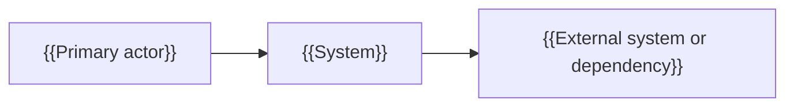
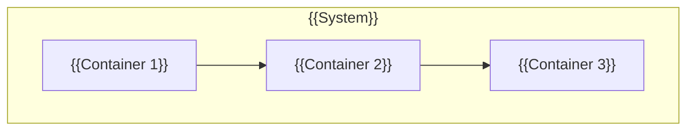
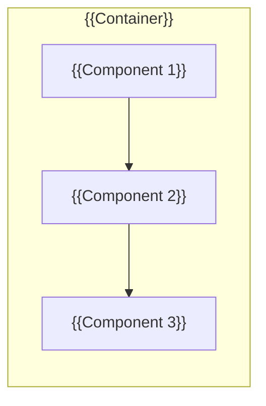
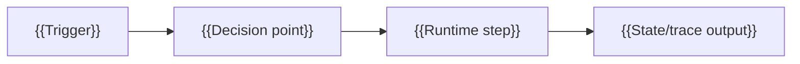
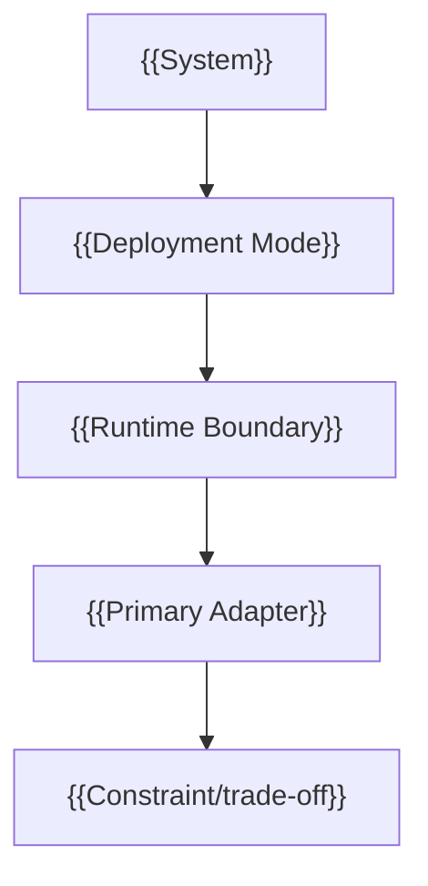

# {{ProjectName}} Architecture Design

This is the SpecCoding template for project-root `README_ArchDesign.md`. Create or update it from `SPEC_takeArchDesign` when a story changes module-context architecture, consuming-system context, architecture views, module boundaries, dependencies, data flow, runtime placement, or key decisions.

## Context

- Story link: {{.catdd/spec/doingUS/YYYYMMDD-UserStory.md or todo/done link}}
- Related overview: [README](README.md)
- Related ubiquitous language & concept model: [README_UbiLang](README_UbiLang.md)
- Related detail design: [README_DetailDesign](README_DetailDesign.md)

## Core System Concepts & Bounded Contexts

<!-- How: System concepts are the KEY to both system architecture and Ubiquitous Language.
  Partition the system into Bounded Contexts and name the canonical concepts each module owns;
  keep exact term definitions and forbidden synonyms in README_UbiLang.md.
  (→ SKILL: define-bounded-contexts + define-ubiquitous-language) -->

| Bounded Context / Module | Subdomain Type (`Core / Supporting / Generic`) | Key Owned Concepts (`README_UbiLang.md`) | Upstream / Downstream Context Map (`ACL / OHS / PL / Conformist`) |
| --- | --- | --- | --- |
| `{{ContextOrModule1}}` | `{{Core}}` | `{{CanonicalConcept1}}`, `{{CanonicalConcept2}}` | {{Upstream/Downstream integration pattern}} |
| `{{ContextOrModule2}}` | `{{Supporting / Generic}}` | `{{CanonicalConcept3}}` | {{Upstream/Downstream integration pattern}} |

## Module Context

| Item | Description |
| --- | --- |
| Target module | {{Module name}} |
| Module mission | {{What this module owns and why it exists}} |
| Public surface | {{API/commands/events exposed by this module}} |
| Out-of-module responsibilities | {{What this module explicitly does not own}} |

## Consuming-System Context

| Consumer System | Interaction | Contract Boundary | Failure/Trust Boundary |
| --- | --- | --- | --- |
| {{System A}} | {{How it uses this module}} | {{API/protocol/version boundary}} | {{error propagation, retry, ownership}} |
| {{System B}} | {{How it uses this module}} | {{API/protocol/version boundary}} | {{error propagation, retry, ownership}} |

## Architecture Goals

- {{Goal 1}}
- {{Goal 2}}
- {{Constraint}}

## Stakeholders and Concerns

<!-- How: Identify who needs this architecture view and which concern each view answers.
  Cover at least users, developers, maintainers, operators, and support when relevant.
  (→ SKILL: design-architecture-viewpoints) -->

| Stakeholder | Primary Concern | Viewpoint Needed | Design Response |
| --- | --- | --- | --- |
| {{Users / clients}} | {{capability, workflow, reliability}} | {{Context / Functional / Operational}} | {{how the architecture addresses it}} |
| {{Developers}} | {{module ownership, integration, testability}} | {{Functional / Development}} | {{how the architecture addresses it}} |
| {{Operators}} | {{deployment, observability, recovery}} | {{Deployment / Operational}} | {{how the architecture addresses it}} |

## Architecture Characteristic Derivation

<!-- How: Derive architectural characteristics from business/domain drivers before decomposing components.
  Keep only characteristics that materially influence structure; mark tactical-only concerns as Not-Architectural. -->

| Driver / Concern | Source | Explicit or Implicit | Composite Decomposition | ASR ID | Why Architectural (Structural Impact) | Target Quantum (`Q-ID`) |
| --- | --- | --- | --- | --- | --- | --- |
| {{Business driver or domain concern}} | {{story/stakeholder/domain}} | {{Explicit / Implicit}} | {{e.g. Agility -> deployability + testability + modularity}} | {{ASR-1 or Not-Architectural}} | {{How it changes boundaries, coupling, or topology}} | {{Q-01 / Cross-Quantum / N/A}} |

## Architecturally Significant Requirements

<!-- How: Extract quality and structural drivers before choosing patterns or technologies.
  Use measurable response measures; do not keep vague goals such as "fast" or "robust".
  (→ SKILL: apply-architectural-tactics + define-architectural-drivers) -->

| ASR ID | Quality / Driver | Target Quantum (`Q-ID`) | Source | Scenario (Source, Stimulus, Environment, Response, Measure) | Priority |
| --- | --- | --- | --- | --- | --- |
| ASR-{{n}} | {{Availability / Performance / Security / Modifiability / Testability / Usability / Constraint}} | {{Q-01 / Cross-Quantum}} | {{story/design/source}} | {{source; stimulus; environment; response; response measure}} | {{H/M/L value, H/M/L difficulty}} |

## Tactics and Tradeoffs

| ASR | Selected Tactic / Pattern | Why This Tactic | Sensitivity Point | Tradeoff Point | Risk / Non-Risk |
| --- | --- | --- | --- | --- | --- |
| ASR-{{n}} | {{tactic or pattern}} | {{why it satisfies the measurable scenario}} | {{decision variable that strongly affects outcome}} | {{quality attributes affected in opposite directions}} | {{risk or non-risk statement}} |

## Architecture Quanta

<!-- How: A quantum is the smallest independently deployable, functionally cohesive scope with its own
  characteristic profile. A monolith may legitimately be a single quantum (Q-01). -->

| Quantum ID (`Q-ID`) | Responsibility & Bounded Context | Deployment Unit | Owned Data / State | Static / Sync Dependencies | Characteristic Profile (`ASR IDs`) | Coupling / Collapse Note |
| --- | --- | --- | --- | --- | --- | --- |
| `Q-01` | {{Cohesive capability / context}} | {{Process / CLI / container / firmware image}} | {{Exclusive state / schema / none}} | {{Sync calls, shared DB, static libs}} | {{ASR-1, ASR-2}} | {{Why independent or what collapses it with peers}} |

## Px-SpecFlow Architecture-Oriented Coverage

Declare how this architecture design handles the architecture-oriented SPEC surfaces defined by Px-SpecFlow. Mark each concern as covered here, delegated to an existing document, deferred to a later SPEC doc, or not applicable.

| Surface | Gated CaTDD Lenses / Categories (`Source-of-Truth Gate`) | Handling | Follow-up Trigger |
| --- | --- | --- | --- |
| `README_UbiLang.md` | Normative vocabulary & concept invariants across `P0-P3` | {{covered/delegated/deferred/not applicable}} | {{When new core system concepts, bounded contexts, or normative terms are introduced}} |
| `README_UsageDesign.md` | `P0 Typical`, `P0 Edge`, `P0 Misuse`, `P3 DemoExample` | {{covered/delegated/deferred/not applicable}} | {{When to create or update}} |
| `README_ErrorDesign.md` | `P0 Misuse`, `P0 Fault`, `P2 Robust` | {{covered/delegated/deferred/not applicable}} | {{When to create or update}} |
| `README_ResourceDesign.md` | `P1 Capability`, `P1 Concurrency`, `P2 Performance`, `P2 Robust` | {{covered/delegated/deferred/not applicable}} | {{When to create or update}} |
| `README_StateDesign.md` or ArchDesign state chapter | `P1 State`, `P1 Interaction` | {{covered/delegated/deferred/not applicable}} | {{When to create or update}} |
| `README_PerfDesign.md` | `P2 Performance`, `P1 Capability` | {{covered/delegated/deferred/not applicable}} | {{When to create or update}} |
| `README_CompatDesign.md` | `P2 Compatibility`, `P2 Configuration` | {{covered/delegated/deferred/not applicable}} | {{When to create or update}} |
| `README_DiagnosisDesign.md` | `P2 Diagnosis` | {{covered/delegated/deferred/not applicable}} | {{When to create or update}} |
| `README_SecurityDesign.md` | `P2 Security`, `P1 Capability`, `P1 Interaction`, `P0 Misuse` | {{covered/delegated/deferred/not applicable}} | {{When to create or update}} |
| `README_ArchVerifyDesign.md` / `README_VerifyDesign.md` | Promoted `SysTesting`/`UserTesting` TPs & system `Arch-Fitness` | {{covered/delegated/deferred/not applicable}} | {{When verification topology, environments, or doubles change}} |

## Architecture Views

Use Mermaid-renderable C4-style views or an equivalent explicit view model. Keep views high-level; detailed class/interface design belongs in `README_DetailDesign.md`.

### C4 Level 1: System Context View



### C4 Level 2: Container View



### C4 Level 3: Component View



### Runtime Execution View



### Deployment View



## Module Boundaries

| Module | Quantum (`Q-ID`) | Responsibility | Public Surface | Owned Data |
| --- | --- | --- | --- | --- |
| {{Module}} | {{Q-01}} | {{Responsibility}} | {{API/command/file}} | {{Data/state}} |

## Dependencies

| Dependency | Direction | Boundary Scope (`Intra-Quantum / Cross-Quantum`) | Reason | Risk |
| --- | --- | --- | --- | --- |
| {{Dependency}} | {{A -> B}} | {{Intra-Quantum / Cross-Quantum}} | {{Why needed}} | {{Risk or mitigation}} |

## Data Flow

```text
{{Input}} -> {{Component}} -> {{Output}}
```

## Inter-View Consistency Checks

<!-- How: Check that architecture views agree before detail design starts.
  Every external system should map to an interface; every logical component should map to a
  development module; every runtime process should map to deployment/operation evidence. -->

| Check | Result | Follow-up |
| --- | --- | --- |
| Context vs Functional | {{all external systems map to interfaces / gap}} | {{follow-up if any}} |
| Functional vs Development | {{components map to modules/packages / gap}} | {{follow-up if any}} |
| Functional vs Data Topology | {{owned data and read/write topology match quantum profiles / gap / N/A}} | {{follow-up if any}} |
| Functional vs Concurrency | {{runtime execution maps to process/thread/task model / gap}} | {{follow-up if any}} |
| Concurrency vs Deployment | {{processes/tasks map to deployment nodes or runtime modes / gap}} | {{follow-up if any}} |
| Deployment vs Operational | {{deployment has monitoring, diagnosis, install, and recovery hooks / gap}} | {{follow-up if any}} |
| Deployment vs Team/Enterprise Standards | {{quantum/module ownership and repository/governance constraints align / gap / N/A}} | {{follow-up if any}} |

## Embedded and Digital Media Architecture Points

Embedded software points:

- Hardware boundary: {{MCU/SoC/peripheral/driver boundary}}
- RTOS/task boundary: {{task/thread/ISR/timer ownership}}
- DMA/cache/bus path: {{DMA buffer, cache coherency, bus bandwidth risk}}
- Power/clock domain: {{sleep, wake, clock, reset, watchdog constraints}}

digital video/audio points:

- Media pipeline: {{capture/demux/decode/process/encode/render path}}
- Buffer topology: {{ring buffer, frame queue, audio queue, ownership handoff}}
- Format boundary: {{codec, sample format, pixel format, color space, container}}
- Sync boundary: {{PTS/DTS, clock source, A/V sync, jitter tolerance}}

## Key Decisions

<!-- How: Record architecture-significant choices (including architecture style/pattern selection when topology changes)
  at ADR quality. Use controlled modal vocabulary (MUST / MUST NOT / SHOULD) for compliance obligations.
  (→ SKILL: document-architectural-decisions) -->

| Decision ID | Status & Owner | Context & Forcing Conditions (`ASR / Q-ID`) | Alternatives & Criteria | Selected Decision (`MUST` / `MUST NOT` / `SHOULD`) | Consequences & Accepted Risks | Compliance / Fitness Link | Supersedes / Re-evaluate When |
| --- | --- | --- | --- | --- | --- | --- | --- |
| `ADR-01` | {{Proposed / Accepted / Superseded}} ({{Owner}}) | {{Driver, ASR, or quantum constraint forcing choice}} | {{Candidate styles/patterns/options + criteria}} | {{Normative decision statement}} | {{Trade-off, cost, accepted risk}} | {{FF-01 / TP / CI gate / review}} | {{Supersedes: none; Re-evaluate when: condition}} |

## Architecture Fitness Functions

<!-- How: Connect every critical ASR and ADR to an objective integrity check.
  Route behavioral/envelope obligations to CaTDD P0/P1/P2/P3 TPs (owned by README_DetailVerifyDesign.md / README_ArchVerifyDesign.md),
  and keep structural/organizational checks as Non-TC Arch-Fitness so they are never forced into fake unit tests. -->

| Fitness ID | Governed `ASR / ADR / Q-ID` | Verification Route (`CaTDD P0/P1/P2/P3 TP` vs. `Non-TC Arch-Fitness: Static / Monitor / Chaos / Manual`) | Signal or Exact Predicate | Threshold / Pass Criterion | Check Point (`CI / HIL / Release / Review`) | Owner & Evidence Artifact |
| --- | --- | --- | --- | --- | --- | --- |
| `FF-01` | {{ASR-1 / ADR-01 / Q-01}} | {{e.g. Non-TC Arch-Fitness: Static-Analysis or CaTDD P2 Performance TP}} | {{Forbidden import cycle / latency / recovery time}} | {{Zero violations / source-backed bound}} | {{CI / HIL / Release}} | {{Owner + script/test/report path}} |

## Risks and Constraints

| Risk ID | Context (`ASR / Q-ID / ADR`) | Impact x Likelihood (`Uncertainty`) | Trend (`Improving / Stable / Degrading`) | Mitigation (`ADR / FF / TP`) | Owner & Status |
| --- | --- | --- | --- | --- | --- |
| `RISK-01` | {{Boundary, dependency, or unproven tech}} | {{H/M/L x H/M/L (Known / High-Unknown-Tech)}} | {{Improving / Stable / Degrading}} | {{ADR-01 / FF-01 / TP}} | {{Owner + Mitigated / Accepted / Open}} |

Constraints:

- {{Constraint}}
- {{Mitigation or follow-up}}

## Usage Example

Run from the repository root to instantiate this architecture template into a temporary file:

```bash
TMP_DOC="$(mktemp -d)/README_ArchDesign.md"
cp slashCommands/templates/README_ArchDesignTemplate.md "$TMP_DOC"
sed -n '1,100p' "$TMP_DOC"
```

Expected result: the temporary file shows architecture sections for characteristic derivation, quanta, views, boundaries, dependencies, data flow, ADR-grade decisions, fitness functions, and risks.

## Review Checklist

- Architecture decisions are traceable to a user story or project constraint.
- Stakeholders and concerns map to the selected viewpoints.
- Architecture characteristics are derived from business/domain drivers, decomposed when composite, and filtered for structural significance before component decomposition.
- At least three ASRs use measurable quality-attribute scenario format and assign a target quantum (`Q-ID`) when architecture quality is in scope.
- Selected tactics trace to ASRs and expose sensitivity/tradeoff points.
- Architecture quanta (`Q-ID`) declare deployment units, owned state, static dependencies, and coupling/collapse boundaries.
- Mermaid-renderable C4-style context, container, component, runtime, and deployment views are present or explicitly marked not applicable.
- Px-SpecFlow architecture-oriented surfaces and their gated CaTDD `P0/P1/P2/P3` lenses are covered, delegated, deferred, or marked not applicable.
- Inter-view consistency checks (including data topology and team/enterprise intersections when relevant) are explicit before detail design starts.
- Module boundaries and intra/cross-quantum dependencies are explicit enough for implementation and review.
- Key Decisions record ADR-grade context, alternatives, normative decision wording (`MUST` / `MUST NOT` / `SHOULD`), consequences, compliance/fitness links, and re-evaluation triggers.
- Architecture Fitness Functions route every critical ASR/ADR to either a CaTDD `P0/P1/P2/P3` TP or a `Non-TC Arch-Fitness` check with an owner and threshold.
- Architecture risks record impact, likelihood, uncertainty, trend, and mitigation links.
