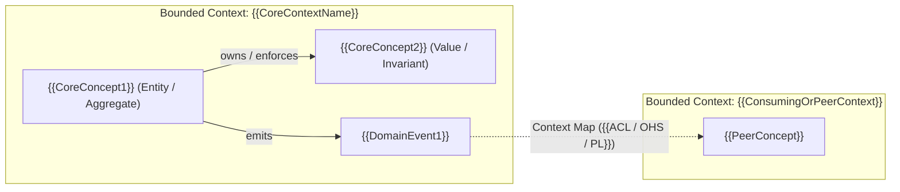

# {{ProjectName}} Ubiquitous Language & Normative Vocabulary

This is the SpecCoding template for project-root `README_UbiLang.md`. This file is an **Architecture-Oriented** SPEC surface (`1. Architecture-Oriented` in `Px-SpecFlow`) and serves as the canonical project-level and bounded-context dictionary for domain ubiquitous language (`EPIC I2.1`) and controlled normative vocabulary (`EPIC E1.3 / E1.4`).

Create or update it via `SPEC_takeArchDesign` / `SPEC_updateArchDesign` (and gate it via `SPEC_reviewArchDesign`; `SPEC_updateUserStory` may propose new domain terms when requirement scope introduces them). Reference it as a 1-line `REFERENCE` link in `.catdd/spec/projectContext.md` via `SPEC_initProjectContext` / `SPEC_updateProjectContext` so `.catdd/spec/projectContext.md` stays within its 200-line working-memory budget without duplicating glossary tables.

---

## 1. Controlled Normative Vocabulary (`EPIC E1.4`)

All User Stories (`*-UserStory.md`), project ledgers (`README_UserStories.md`), architecture and detail designs (`README_*Design.md`), CaTDD test skeletons (`@[Expect]` and `VERIFY`), and slash-command contracts **MUST** use this controlled modal vocabulary:

| Keyword (EN / ZH) | Operational Meaning | Gate & Test Impact |
| --- | --- | --- |
| **`MUST`** (`必须` / `SHALL`) | **Hard mandatory obligation.** No exception is allowed without revising the specification. | **MUST** trace to at least one `TP` / `TC` in `discovery_ledger` and blocks the review gate (`REVISE`) if unverified. |
| **`MUST NOT`** (`严禁` / `绝不` / `SHALL NOT`) | **Hard prohibition or safety/security boundary.** | **MUST** trace to a defensive `Misuse`, `Fault`, or `Security` `TP` / `TC`, or a `Conflict Guard` rule. |
| **`SHOULD` / `SHOULD NOT`** (`应当` / `不应`) | **Conditional preference or default tactic.** Allowed to deviate **only** when a documented tradeoff, ADR, or explicit exception condition is recorded. | Unjustified deviation triggers a review finding (`REVISE` or `advisory`); unbacked lowercase `"should"` in an AC is flagged as `SMELL-MODAL`. |
| **`MAY`** (`可以` / `可选`) | **Explicitly optional behavior or non-blocking extension.** | Never blocks a required gate; if tested, belongs to optional `Edge` / `Configuration` or `REFERRED` scope. |

---

## 2. Core System Concept Model (`Strategic Architecture & DDD`)

<!-- How: A system's Core Concepts ARE the key to its architecture and its Ubiquitous Language.
     Map how the core domain concepts (Entities, Aggregates, Value Objects, Invariants, Events, and
     Bounded Context boundaries) relate before detailing classes or APIs in README_DetailDesign.md.
     (→ SKILL: define-ubiquitous-language + define-bounded-contexts) -->



---

## 3. Project Domain Ubiquitous Language (`EPIC E1.3 & I2.1`)

Every core system concept in `{{ProjectName}}` **MUST** have one canonical term, one concept role, and one exact definition within its Bounded Context below. Review gates (`SPEC_reviewUserStory`, `SPEC_reviewArchDesign`, `SPEC_reviewDetailDesign`, `SPEC_reviewProductCodes`) check for **synonym drift** (`SMELL-MODAL` / `I2.1`) and reject unapproved aliases.

| Canonical Term | Concept Role (`Entity / Value / Invariant / Event / Boundary`) | Bounded Context / Scope | Exact Definition | Forbidden Synonyms / Aliases | Source / Owner |
| --- | --- | --- | --- | --- | --- |
| `{{CanonicalTerm1}}` | `{{Entity / Aggregate}}` | `{{Module / Service / Global}}` | {{One-sentence exact semantic definition of the core system concept}} | {{Rejected aliases that MUST NOT be used for this concept}} | `{{US-n / README_ArchDesign.md}}` |
| `{{CanonicalTerm2}}` | `{{Value / Invariant / Boundary}}` | `{{Module / Service / Global}}` | {{One-sentence exact semantic definition}} | {{Rejected aliases}} | `{{US-n / README_ArchDesign.md}}` |

---

## 4. Enumerated Domain States & Value Sets (`EPIC E1.3`)

| Domain Attribute / State Machine | Allowed Canonical Values | Invalid / Rejected Values | Owning Design Surface |
| --- | --- | --- | --- |
| `{{StateOrEnumName}}` | `{{VALUE_A}}`, `{{VALUE_B}}`, `{{VALUE_C}}` | {{Any unlisted string or state transition}} | `[README_StateDesign.md](README_StateDesign.md)` |

---

## Sync & Review Rules

- **No Synonym Drift (`I2.1`)**: Do not use multiple terms (for example `session` vs `conversation`, or `adapter` vs `handler`) for the same boundary across `*-UserStory.md`, `README_ArchDesign.md`, `README_DetailDesign.md`, test skeletons, and code.
- **No Duplication in `projectContext.md`**: Keep the full glossary table here in `README_UbiLang.md`; `.catdd/spec/projectContext.md` **MUST** only link to `README_UbiLang.md` as `REFERENCE` memory.
- **Story Delta Check**: When `SPEC_analyzeIssue`, `SPEC_analyzeFeature`, or `SPEC_updateUserStory` introduces or changes a domain term, add or update its row here before `SPEC_reviewUserStory` passes.

## Usage Example

Run from the repository root to instantiate this ubiquitous-language template into a temporary file:

```bash
TMP_DOC="$(mktemp -d)/README_UbiLang.md"
cp slashCommands/templates/README_UbiLangTemplate.md "$TMP_DOC"
sed -n '1,80p' "$TMP_DOC"
```

Expected result: the temporary file shows the Controlled Normative Vocabulary (`MUST`, `MUST NOT`, `SHOULD`, `MAY`) and Project Domain Ubiquitous Language tables ready to customize.
